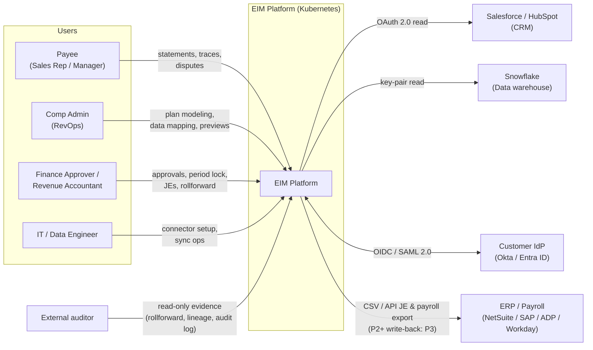
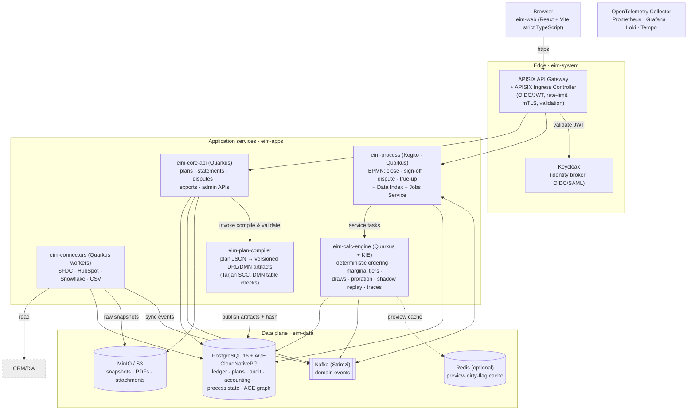
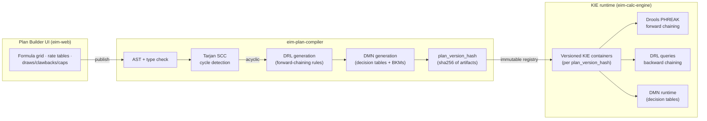
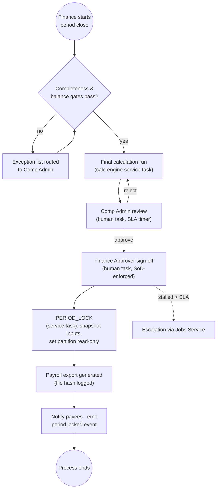
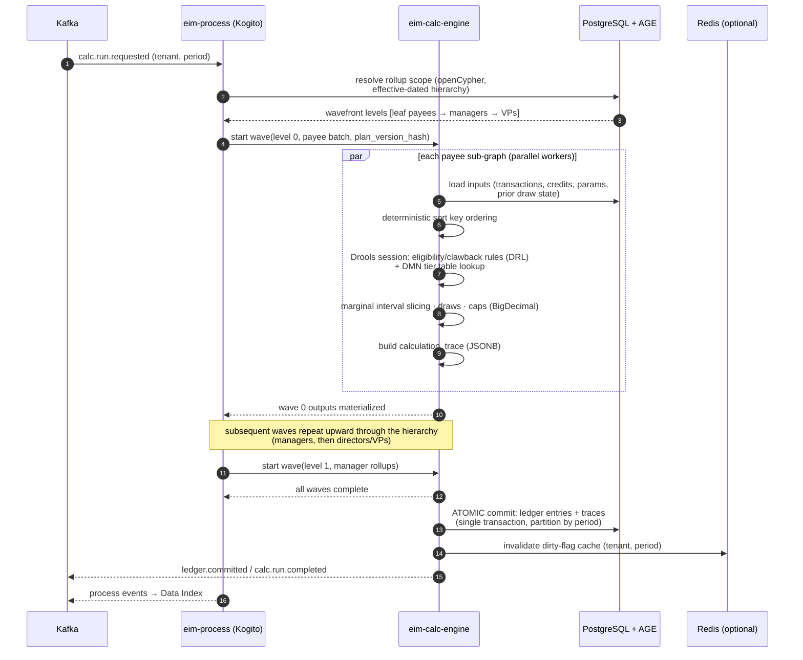
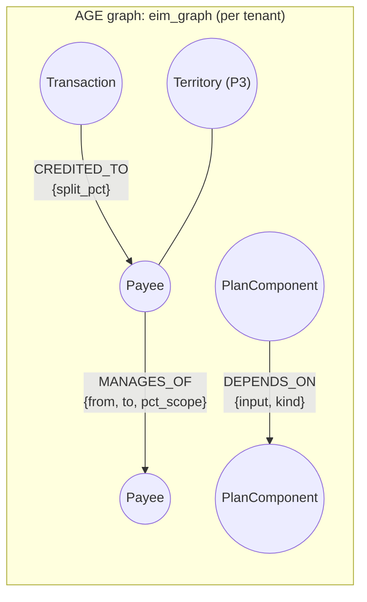
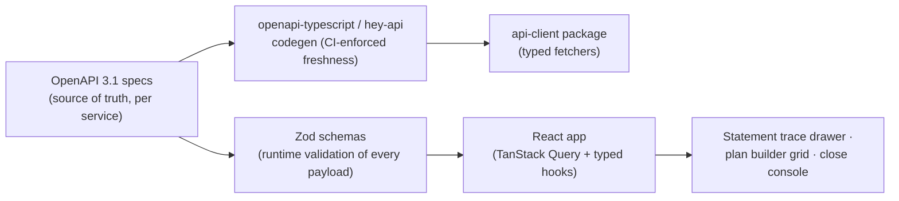
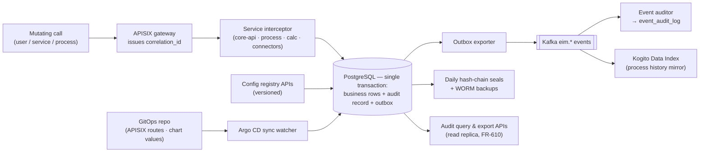
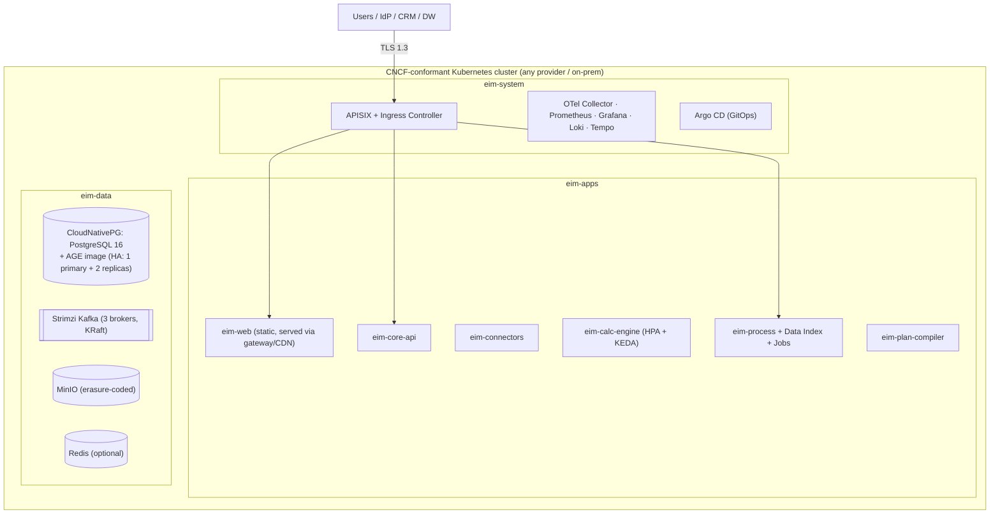

# EIM Platform — Architecture Plan

| | |
|---|---|
| **Document status** | Draft v1.1 — adds §12 Audit architecture: enforced detailed audit for all events and configuration changes |
| **Date** | 2026-10-28 |
| **Source** | Derived from *EIM Platform Business Proposal.pdf*, constrained by the platform mandates below |
| **Companion documents** | [01-functional-requirements.md](01-functional-requirements.md) · [02-non-functional-requirements.md](02-non-functional-requirements.md) |

---

## 1. Purpose

This document defines the target technical architecture for the EIM platform across the three roadmap phases, reconciling the business proposal's engineering ideas (Rust calculation worker, Temporal.io orchestration, Redis cache) with the **mandated technology stack**.

### 1.1 Mandated constraints

| # | Constraint | Realized by |
|---|---|---|
| C1 | **Cloud-agnostic, running on Kubernetes** | CNCF-conformant K8s only; Helm umbrella chart; stateful services via operators (CloudNativePG, Strimzi, MinIO) — no managed cloud services in the critical path (NFR-80/81) |
| C2 | **PostgreSQL as the database** | PostgreSQL 16+ as the single system of record: ledger, plans, audit, accounting subledger, process-engine state |
| C3 | **APISIX as the API gateway** | APISIX + APISIX Ingress Controller: the sole north-south entry; authN, rate limiting, mTLS termination |
| C4 | **Strict type-safe TypeScript frontend** | React + Vite monorepo, maximal `tsconfig` strictness, OpenAPI-generated types, Zod runtime validation |
| C5 | **AGE extension for PostgreSQL** | Apache AGE property graph alongside relational tables: effective-dated org/credit/plan-dependency graphs |
| C6 | **Drools: forward-chaining + backward-chaining rule engine, DMN decision engine** | Drools DRL (PHREAK forward chaining; `query`-based backward chaining) for business-rule inference; Drools DMN for decision tables (tier configuration, ASC 606 classification) |
| C7 | **Kogito for cloud-native business process automation** | Kogito (kie.apache.org/kogito) runtime for BPMN2 processes: period close, approvals, dispute lifecycle, true-up queue; PostgreSQL persistence, Kafka eventing, Data Index + Jobs Service |

### 1.2 Architecture principles

1. **The ledger is the product.** Every design decision defers to immutability, determinism, and lineage of commission records (NFR-01–08).
2. **Decisions are artifacts.** Plan logic, rate tables, and accounting policy compile into *versioned* DRL/DMN artifacts with content hashes — never interpreted ad hoc from UI JSON at calculation time.
3. **Orchestration is a process.** Anything with states, humans, timers, or escalations is a BPMN process in Kogito — auditable by construction (FR-621), not a hand-rolled state table.
4. **Graph questions go to the graph.** Rollups, hierarchy, dependencies, and (P3) territories resolve in AGE via openCypher, not recursive CTEs.
5. **One platform, portable anywhere.** The same charts deploy to any conformant cluster (NFR-80); environment specifics are values, not code.
6. **Nothing changes unaudited.** Every state change, published event, and configuration change writes a detailed, tamper-evident audit record in the same transaction — enforced by architecture, verified by CI (AD-9, §12).

---

## 2. Key architecture decisions

| ID | Decision | Rationale & consequences |
|---|---|---|
| AD-1 | **Hybrid engine: Kogito/Drools orchestrate; a dedicated JVM calculation service computes.** | The proposal's marginal tier-splitting, draw state machine, and bi-temporal replay demand tight, deterministic numeric control (BigDecimal, interval math, wavefront scheduling). Drools evaluates *business rules* (eligibility, clawback policy) and DMN evaluates *decision tables*; the heavy ledger math stays in a purpose-built stateless Quarkus service invoked as a process service task. Rejects the proposal's Rust worker (single JVM toolchain, KIE-native integration); performance risk mitigated by stateless horizontal scaling (NFR-30) and columnar in-memory batching. Also rejects Temporal.io: Kogito BPMN fulfills the orchestration mandate (C7). |
| AD-2 | **PostgreSQL is the only system of record.** | Ledger partitioning (by payout period), RLS for payee isolation, JSONB traces, and process-engine JDBC persistence in one ACID store — enabling cross-domain transactional integrity (e.g. ledger + audit + process state). AGE (C5) rides the same cluster in a dedicated database. |
| AD-3 | **AGE for graph-shaped domains.** | Effective-dated reporting trees, credit-split graphs, and plan-component dependency DAGs are graphs; openCypher recursion outperforms and out-reads recursive CTEs for rollup resolution (NFR-24) and gives natural cycle detection. Relational tables remain the source of truth; the graph is a maintained projection (see §9.3). |
| AD-4 | **APISIX as the single edge.** | Mandated (C3). JWT verification, per-tenant rate limits, mTLS, and request validation centralized; no service is reachable except through the gateway (NFR-51). |
| AD-5 | **Frontend types are generated, never hand-written.** | OpenAPI → TypeScript codegen + Zod schemas + maximal strict flags; type drift fails CI (NFR-103). |
| AD-6 | **Operators for stateful infra; nothing cloud-managed.** | CloudNativePG (PostgreSQL + AGE image), Strimzi (Kafka), MinIO (S3-compatible). Portability = re-deploy the same charts (NFR-80–82). |
| AD-7 | **Kafka as the event backbone.** | Domain events between ingestion, calculation, process, and indexing; also the Kogito eventing channel (Data Index, Jobs). Replaces point-to-point coupling; at-least-once + idempotent consumers (NFR-04). |
| AD-8 | **Keycloak as the embedded identity broker.** | Cloud-agnostic OIDC/SAML federation to customer IdPs; the gateway validates Keycloak-issued JWTs. |
| AD-9 | **Audit-first mutation path (mandated enforcement).** | Every state change, published event, and configuration change writes a detailed audit record in the same database transaction — transactional outbox + service interceptors; there is no unaudited code path to regulated state. Coverage is CI-verified and runtime-reconciled (NFR-64). See §12. |

---

## 3. System context (C4 level 1)

## 4. Container architecture (C4 level 2)

### 4.1 Component responsibilities

| Container | Responsibilities | Key FRs |
|---|---|---|
| **eim-web** | Seller portal & statement trace drawer; admin plan builder (formula grid, rate tables, live sandbox); finance close & accounting consoles; dispute UI | FR-4xx, FR-7xx |
| **APISIX gateway** | North-south entry: OIDC/JWT validation, tenant rate limiting, request-size/schema limits, mTLS termination, routing to core/process APIs; issues the correlation ID for every mutating request, feeding the audit plane (§12) | FR-101/102, NFR-51/54 |
| **Keycloak** | Brokers customer IdPs (SAML/OIDC); issues platform JWTs with tenant/role claims; SCIM provisioning | FR-101, FR-104 |
| **eim-core-api** | Domain CRUD & queries: plans (draft state), statements, traces, disputes, exports, connector config, audit viewer; enforces RBAC via token claims + PG RLS; audit interceptor records every mutating call (FR-601); configuration changes only through the versioned, audited config registry (FR-613) | FR-2xx (config), FR-4xx (draft APIs), FR-6xx, FR-7xx, FR-8xx |
| **eim-connectors** | Scheduled/on-demand sync workers; OAuth/key-pair auth; watermark incremental pulls; schema validation & quarantine; raw snapshot archival; every run and every config change audited (FR-612/613) | FR-2xx |
| **eim-plan-compiler** | Compiles published plan versions into DRL/DMN KIE artifacts; Tarjan SCC cycle detection; DMN decision-table completeness/consistency checks; registers `plan_version_hash` | FR-406, NFR-104 |
| **eim-calc-engine** | The deterministic numeric core: sort-key ordering, stateful windows, marginal interval slicing, cliff mode, draws state machine, caps, clawbacks, proration segments, wavefront scheduling over AGE-resolved rollups, bi-temporal shadow replay; embeds Drools (DRL sessions + DMN evaluation) for rule-governed steps; emits atomic ledger batches with JSONB traces; calculation runs and ledger commits emit audited events (FR-612) | FR-5xx |
| **eim-process (Kogito)** | BPMN2 process runtime: period close, multi-step sign-off, dispute lifecycle, true-up queue review, ingestion orchestration; human tasks, timers, escalations; PostgreSQL persistence; Kafka events; Data Index (process queries) + Jobs Service (timers); process history is audit-grade and mirrored to the audit plane (FR-612.3) | FR-6xx, FR-705, FR-604 |
| **PostgreSQL + AGE** | System of record (relational, incl. audit stores & transactional outbox — §12) + graph projection (AGE) — see §9 | all |
| **Kafka** | Domain events: `sync.completed`, `calc.run.requested/completed`, `period.locked`, `ledger.committed`, `dispute.updated`, `trueup.required`; Kogito eventing | cross-cutting |
| **MinIO** | Raw ingestion snapshots, statement PDFs, dispute attachments, export files | FR-203.3, FR-703, FR-704 |
| **Redis (optional)** | Dirty-flag preview cache: `(payee_subgraph_ast_hash + inputs_hash) → result`; enables < 800 ms previews (NFR-23); optional — correctness never depends on it | FR-407, FR-509 |

---

## 5. Rule & decision architecture (Drools — mandate C6)

### 5.1 Division of labor

- **Forward chaining (DRL)** — inference over facts to derive *eligibility and policy outcomes*: which plan components apply to a credited transaction given plan parameters and payee facts; clawback eligibility when churn flags arrive (rule matches on `churn_date ∈ clawback_window` etc.); ASC 606 classification pre-checks (P2, see §5.3); dispute-routing rules (P2 GenAI triage prep, P3). Rules fire in the KIE session per payee-segment; salience and ruleflow orderings are compiler-generated so activations are deterministic (NFR-08).
- **Backward chaining (DRL `query`)** — goal-driven derivation for *explanations*: "why did deal D pay amount A?" reconstructs a session from the frozen period inputs and traces goal derivation backwards through the rule/decision chain. Powers dispute triage pre-tagging (`SOURCE_DATA / CREDIT_SPLIT / WINDOW_STATE / PLAN_LOGIC`, FR-704.1) and auditor Q&A without recomputing payouts.
- **DMN decision engine** — pure decision-table territory, where tabular logic is exactly what business users author and auditors expect:
  - *Rate table validation & authoring semantics* — tier contiguity (FR-403.2) is enforced by DMN table completeness/consistency analysis at publish (NFR-104).
  - *ASC 606 classification policy* (P2) — cost type × policy toggles → Capitalize/Expense + amortization basis (FR-901), authored as DMN decision tables per accounting book so Controllers edit policy without code.
  - *Practical-expedient determination*, *fringe-rate application*, and similar point decisions.
- **What deliberately does *not* live in DMN/DRL**: the marginal tier-splitting interval arithmetic itself (FR-502). Slicing a transaction across `[A_prev, A_curr]` against tier intervals is ordered numeric computation with strict determinism requirements; it is implemented in Java (BigDecimal) inside the calc engine, *driven by* the DMN-published tier tables. DMN BKMs/decision tables provide the numbers; Java performs the math. This is the practical boundary of AD-1.

### 5.2 Artifact lifecycle

1. Admin edits draft plan in eim-web (draft JSON only — never executed).
2. **Publish** → core-api invokes the compiler: type check → Tarjan SCC → generate DRL + DMN → DMN table verification → register artifacts + `plan_version_hash` (immutable).
3. The artifact registry (in PostgreSQL + object storage) retains every version forever; a locked period pins the exact versions in effect (NFR-62).
4. Calc engine loads versioned KIE containers on demand; multiple versions coexist (shadow replay loads *historical* versions — FR-508.1).

---

## 6. Process automation architecture (Kogito — mandate C7)

All stateful, human-in-the-loop flows are BPMN2 processes running in Kogito (Quarkus boot), persisted to PostgreSQL (JDBC), evented over Kafka, with Data Index for process/state queries and Jobs Service for timers/escalations.

### 6.1 Process inventory

| Process (BPMN) | Trigger | Flow summary | FRs |
|---|---|---|---|
| `period-close` | Finance initiates close | completeness checks → calc finalization → Comp Admin review (human) → Finance sign-off (human) → `PERIOD_LOCK` (service task, snapshot inputs) → payroll export handoff → notify payees | FR-603, FR-605, FR-801 |
| `true-up-review` | `trueup.required` event | queue item with diff report → Finance review/approval (human, SLA timer) → shadow-replay diff re-check → post `PRIOR_PERIOD_TRUEUP` ledger entries | FR-604, FR-508 |
| `dispute-lifecycle` | Payee submits | auto-triage (backward-chaining pre-tag) → Comp Admin review (human, SLA) → approve/reject → on approve: adjustment entry + audit link | FR-704, FR-705 |
| `ingestion-run` | Schedule / on-demand | connector run → validation/quarantine report → on retro-change detection: emit `trueup.required` | FR-2xx |
| `accounting-close` (P2) | Month-end | completeness gate (FR-908) → JE preview → Controller approval → GL push with retry → ST/LT reclass | FR-907, FR-908 |

### 6.2 Period close process (illustrative)

### 6.3 Kogito on Kubernetes

- Kogito runtimes as standard Deployments (Quarkus, fast startup, low memory); multiple replicas; process state in PostgreSQL makes pods stateless-safe (NFR-32).
- Kafka integration for: process events → Data Index (queryable process state for audit, FR-621.1), Jobs Service timers (escalations), and domain-event subscriptions (`calc.run.requested` starts orchestration).
- Human tasks surface in eim-web via process/task APIs through the gateway.

---

## 7. Calculation architecture (hybrid engine — AD-1)

### 7.1 End-to-end calculation pipeline

### 7.2 Inside the calc engine

- **Determinism core**: single sort key `(transaction_date, source_ts_utc, transaction_uuid)`; no concurrent iteration anywhere near numeric state (NFR-03/08).
- **Wavefront scheduler**: levels come from an AGE openCypher traversal (longest-path layering over the effective-dated reporting graph). Each level's payee sub-graphs are independent → parallel worker pool; a manager's wave waits for all downline outputs (FR-503).
- **State machine engines**: draws (FR-504) and clawbacks (FR-505) as explicit, unit-tested state machines; state persisted per payee/period in PG, loaded at wave start.
- **Bi-temporal shadow replay** (FR-508): load frozen inputs *as-of lock timestamp* + merge retro deltas → re-execute with the *pinned historical* plan_version artifacts in an isolated memory space → set-diff `(payee_id, transaction_id, plan_component_id)` → emit true-up deltas for the open period. Never writes to the closed partition.
- **Preview path**: same engine, single-payee scope, sandboxed inputs (synthetic deals never persisted, FR-407.2); Redis dirty-flag cache short-circuits unchanged `(ast_hash, inputs_hash)` pairs (FR-509).
- **Precision**: `BigDecimal` (DECIMAL128 semantics) end-to-end; rounding exactly once at payout emission (NFR-02).

### 7.3 Scaling

Calc workers are stateless and horizontally scaled; KEDA scales on `calc.run.requested` topic lag + queue depth; a run is partitioned into payee-shard tasks so 5,000-payee cohorts parallelize across pods (NFR-20/21, AD-1 mitigation).

---

## 8. API & event architecture (APISIX — mandate C3)

### 8.1 Gateway topology

- **APISIX Ingress Controller** watches Kubernetes `ApisixRoute`/`ApisixClusterConfig` resources; routes declared as code beside each service's Helm chart.
- Central policies at the gateway: `openid-connect` (Keycloak JWT validation), `limit-count`/`limit-req` per tenant (consumer abstraction), `consumer-restriction`, request-body size limits, URI/schema allowlists, mTLS client-cert auth for machine-to-machine tenants (P3 partner portals), response caching for static assets.
- Service-to-service traffic inside the mesh uses mTLS; only the gateway holds public certificates (NFR-51).

### 8.2 API surface

- REST + OpenAPI 3.1 for all services; the OpenAPI specs are the contract from which frontend types are generated (AD-5) and contract tests run (NFR-101).
- Versioned `/api/v1/...` paths; breaking changes ship new versions with overlap windows.

### 8.3 Domain events (Kafka topics)

| Topic | Producer → Consumer | Purpose |
|---|---|---|
| `eim.sync.{completed,failed}` | connectors → process, core | ingestion results, retro-change detection |
| `eim.calc.run.{requested,completed}` | process/core → calc | calculation orchestration |
| `eim.ledger.committed` | calc → process, Data Index | post-commit reactions (exports, notifications) |
| `eim.period.{locked,reopened}` | process → core, connectors | freeze/unfreeze behavior |
| `eim.trueup.required` | connectors/core → process | queue true-up reviews (FR-604) |
| `eim.dispute.{created,updated}` | core ↔ process | dispute lifecycle sync |
| `eim.audit.appended` | audit exporter → SIEM / analytics sink (optional) | audit stream export; the PostgreSQL audit stores remain the system of record (§12) |

Consumers are idempotent under at-least-once delivery (NFR-04); every event carries `tenant_id`, `correlation_id`, `occurred_at`.

---

## 9. Data architecture (PostgreSQL + AGE — mandates C2, C5)

### 9.1 Relational core

Schemas per FR document §12: `payee`, `plan_assignment`, `comp_plan`/`plan_version`, `raw_transaction`, `credit_allocation`, `commission_ledger_entry` (declaratively partitioned by `payout_period_id`), `payout_period`, `dispute_ticket`, plus P2 accounting: `accounting_book_policy`, `capitalized_cost_asset`, `amortization_schedule_line`, `gl_journal_entry_line`, plus the audit plane (§12): `audit_log`, `event_audit_log`, `configuration_change`, `transactional_outbox`.

Key mechanics:

- **Partitioning**: `commission_ledger_entry` ranged by period; locked partitions switch to read-only tablespace posture (privilege drop) — immutability enforced by the database, not convention (NFR-44).
- **Row-level security**: policies keyed on `app.current_tenant_id` / `app.current_payee_id` session variables set per request by the services from validated JWT claims (FR-103, NFR-52).
- **Migrations**: Flyway, expand/contract only; CI asserts no destructive steps in release scope (NFR-41).
- **Traces**: `calculation_trace JSONB` compressed (`lz4`); queryable via GIN for support workflows.
- **Transactional outbox (audit guarantee)**: business rows, audit records, and event emission commit in one transaction; an exporter drains the outbox to Kafka; a reconciliation job compares mutation, event, and audit counts and alerts on any gap (FR-601.4, NFR-64 — see §12).

### 9.2 Where AGE fits (and where it doesn't)

AGE runs **in a dedicated database** in the same CloudNativePG cluster (custom image with the extension). The relational schema remains the system of record; the graph is a **maintained projection** — services write both within the same logical operation, and a reconciliation job verifies graph ↔ tables consistency (drift alerting, NFR-93).

- `MANAGES_OF` edges carry effective dates (`from`/`to`); as-of traversal uses edge predicates — FR-302/303 rollup resolution.
- `CREDITED_TO` mirrors `credit_allocation` for co-payee ("shared 30% with…") lookups and overlay analysis.
- `DEPENDS_ON` is the plan-component dependency DAG — cycle detection input (Tarjan also runs here at publish, FR-406) and preview dirty-flag scoping (FR-509).
- **Caveat honored in design**: RLS does not apply inside AGE graph catalogs; graph reads/writes occur only from trusted services under service-layer authorization (documented exception to NFR-52 defense-in-depth, with the relational source enforcing RLS).

### 9.3 Graph operations catalog

| Operation | openCypher shape (illustrative) | Served FR |
|---|---|---|
| Rollup scope as-of date | `MATCH (m:Payee {id:$m})-[r:MANAGES_OF*0..]->(p:Payee) WHERE r.from <= $d < coalesce(r.to,∞) RETURN p` | FR-303 |
| Wavefront layering | longest-path depth over `MANAGES_OF` forest | FR-503 |
| Cycle detection at publish | reachability over `DEPENDS_ON` | FR-406 |
| Co-payee discovery | `MATCH (t:Transaction)-[c:CREDITED_TO]->(p) RETURN p, c.split_pct` | FR-702.3 |

---

## 10. Frontend architecture (strict TypeScript — mandate C4)

### 10.1 Stack & structure

- **Monorepo**: pnpm + Turborepo — packages: `web-app` (React + Vite), `ui-kit` (design system per UX spec tokens), `api-client` (generated), `schemas` (Zod), `shared-domain` (pure typed domain model: money, fractions, attainment — unit-tested).
- **Strictness gates** (NFR-103): `"strict": true`, `"noUncheckedIndexedAccess": true`, `"exactOptionalPropertyTypes": true`, `"noImplicitOverride": true`, `no` `any`/`as` without documented waiver; typed ESLint rules (`@typescript-eslint`, strict-type-checked) + Prettier; `tsc --noEmit` is a CI gate.
- **Money in the browser**: a `Money` branded type (`Money<Currency>`) built on decimal strings — never JS `number` — mirroring NFR-01 on the client; all display uses `tabular-nums` (NFR-121).

### 10.2 Type-safety pipeline

- Server responses are validated by Zod at the boundary — the UI never trusts wire data, and drift between spec and runtime fails loudly.
- Component state: TanStack Query (server state) + Zustand for local UI state; the plan builder grid is a custom virtualized canvas component per the wireframe specs (keyboard-first, NFR-120).

---

## 11. Security architecture

| Layer | Mechanism |
|---|---|
| Identity | Keycloak brokers customer IdP (SAML 2.0 / OIDC); platform JWTs carry `tenant`, `roles`, `payee_id` claims (FR-101) |
| Edge | APISIX validates JWT signature/audience/expiry, enforces tenant rate limits & size limits; no public path bypasses it (NFR-51/54) |
| Authorization | Role checks in services from claims; **data isolation additionally enforced by PG RLS** session variables (NFR-52); SoD: `PERIOD_LOCK` permission exclusive to Finance Approver role (FR-102) |
| Service mesh | mTLS between all in-cluster services (service mesh or APISIX upstream mTLS); service identities via SPIFFE-style certificates |
| Secrets | External-secrets operator → KMS/Vault-backed; per-tenant encryption keys for connector credentials (NFR-53) |
| Data | AES-256 at rest (PG + MinIO), TLS 1.3 in transit; WORM backup tier for locked-period durability (NFR-44/50) |
| Audit | Unified audit plane — actions, events, and configuration changes; append-only, hash-chained daily seals; security events (authN failures, 403s) alertable (NFR-55/60, FR-612/613) — see §12 |

---

## 12. Audit architecture (mandated enforcement)

**Enforcement rule: every event and every configuration change is audited in detail — no exceptions, no unaudited code paths.**

### 12.1 Audit streams & guarantees

| Stream | Captures | Store | Requirements |
|---|---|---|---|
| **Action audit** | Every state-changing operation by any actor (user, service, process, system): overrides, period lock/reopen, dispute actions, approvals, exports, data corrections, calculation runs | `audit_log` | FR-601, NFR-60 |
| **Event audit** | Every domain event published or consumed (full payload + hash + schema version); every BPMN transition; every external-system exchange (syncs, GL pushes, IdP calls) with secrets redacted | `event_audit_log` | FR-612 |
| **Configuration audit** | Every change to any configuration entity: plans, connectors, accounting policy, workflows, RBAC, flags/thresholds, gateway policies, tenant settings — versioned before/after, reason, approval chain | `configuration_change` | FR-613 |

Guarantees across all three streams:

1. **Same-transaction audit** — the audit record commits atomically with the change it describes (transactional outbox); an audit-write failure aborts the business change (FR-601.4).
2. **Tamper evidence** — append-only at database privilege level; daily hash-chained seals; WORM backup tier (NFR-60).
3. **100% coverage, enforced and verified** — interceptors + the outbox are the only sanctioned mutation path; a CI coverage suite requires every new endpoint and event type to declare its audit mapping; a runtime reconciliation job compares mutation, event, and audit counts and alerts on gaps (NFR-64).

### 12.2 Audit pipeline

- **Mutation path**: services never write regulated state directly; the interceptor wraps each mutation, writing business rows, the audit record, and an outbox entry in one transaction. The exporter then publishes events — guaranteeing *no event without an audit record, and no business change without an event trail*.
- **Configuration plane**: all runtime configuration lives in the versioned config registry (`configuration_change` history, FR-613); governed categories (plans, accounting policy, RBAC, gateway policies, workflow definitions) activate only after a Kogito approval process — whose transitions are themselves audited. Infrastructure configuration declared in Git (APISIX routes, deployment values) is mirrored into the audit plane by the Argo CD sync watcher with commit, author, and sync result (FR-613.5).
- **Process audit**: Kogito process-instance history — every transition, actor, task claim, timer, escalation — is first-class audit evidence, mirrored into `event_audit_log` with the business correlation ID (FR-612.3).
- **Query & export**: audit APIs run on read replicas; all three streams are searchable and exportable (FR-610); the optional `eim.audit.appended` topic streams records to customer SIEM.

### 12.3 Minimum audit detail per record

| Field | Action audit | Event audit | Config audit |
|---|---|---|---|
| Actor | user / service identity + actor type | producer or consumer service | user / service identity |
| Time | UTC timestamp | occurred-at + consumed-at | UTC timestamp + effective dates |
| Target | entity + record ID | event type, topic/partition/offset | config entity + ID + version before/after |
| Payload | before/after JSONB | full payload (compressed) + hash + schema version | before/after JSONB diff |
| Context | correlation ID, source channel, outcome, reason | correlation ID, tenant, processing outcome | reason (mandatory), approval reference, activation state |
| Integrity | hash-chained, append-only | hash-chained, append-only | hash-chained, append-only |

---

## 13. Deployment architecture (Kubernetes — mandate C1)

### 13.1 Topology

### 13.2 Packaging & delivery

- **Helm umbrella chart** (`eim-platform`) with per-component subcharts; stateful infra via operators (CloudNativePG, Strimzi, MinIO operator) — substitutable by customer-provided equivalents via values (NFR-81).
- **GitOps**: Argo CD syncs environments (dev → staging → prod) from the chart registry + environment overlays; image tags pinned by digest; SBOM + CVE scan gate promotion (NFR-57).
- **S3-compatible storage** is the only external dependency *interface* — satisfied by MinIO in-cluster or a customer's existing object store.
- **Reference sizing** (NFR-20 baseline): 3× app pods each (250m/512Mi), calc workers 3–30 pods autoscaled (1 vCPU/1Gi each), PostgreSQL HA on 3 nodes (4 vCPU/16Gi, NVMe), Kafka 3 brokers. Benchmarks in CI track the 500×100k < 15s budget on this shape.

### 13.3 Environments & CI/CD

- Every merge: unit + golden calculation suites (NFR-100), contract tests (NFR-101), type gates (NFR-103), **audit-coverage suite — every new endpoint/event type must declare its audit mapping (NFR-64)**, chart lint + `helm template` on the substitution matrix (NFR-81).
- Nightly: performance benchmarks (NFR-20/22/23), kind-cluster full-stack smoke deploy.
- Release: staging full suite incl. chaos (pod kills mid-process/mid-calc — NFR-32) and restore drill evidence.

---

## 14. Observability architecture

- **Tracing**: OpenTelemetry SDKs in every service; the correlation ID issued at the gateway flows through process → calc → DB commits and is visible in the UI (NFR-90); BPMN process-instance IDs join traces to auditable process history.
- **Metrics**: per-service RED metrics + domain metrics (`eim_calc_duration_seconds` histogram, `eim_ledger_entries_committed`, `eim_disputes_open`, `eim_trueups_pending`) with SLO dashboards and error budgets (NFR-91).
- **Logs**: structured JSON, tenant/correlation-scoped; no PII or payout amounts at INFO (NFR-92).
- **Alerting**: runbook-linked alerts for run failures, stuck processes (Jobs Service liveness), connector failures, backup/restore failures, SLO burn (NFR-93).

---

## 15. Performance strategy

| Concern | Approach |
|---|---|
| 15s / 500×100k budget | Wavefront parallelism + payee-shard task partitioning across autoscaled workers; columnar batching (Apache Arrow) on the ingest→compute path; prepared statement reuse; single atomic COPY-based ledger write |
| JVM memory/GC pressure (vs proposal's Rust) | Stateless workers with small heaps; primitive-friendly data layouts; no GC-sensitive long-lived sessions per run; ZGC fallback tuned via load tests (risk R-1) |
| Preview < 800 ms | Dirty-flag cache scoped by AGE `DEPENDS_ON` sub-graph (FR-509); single-payee sandbox execution |
| Rollup queries | AGE traversal with effective-date predicates; graph sized for 5k payees is trivially small; < 2s budget with big headroom (NFR-24) |
| Reporting (500k schedule lines) | Read replicas (CloudNativePG) for reporting APIs; partition pruning by accounting period |

---

## 16. Risks & mitigations

| # | Risk | Impact | Mitigation |
|---|---|---|---|
| R-1 | JVM throughput misses the 15s SLA at scale (AD-1 replaces Rust) | NFR-20 breach | Stateless horizontal scaling + Arrow batching + nightly benchmarks with 20% regression alerts; escape hatch: the calc engine's service-task contract allows a future native worker per shard without process changes |
| R-2 | AGE maturity: backup/restore and upgrade caveats (pg_dump of graph catalogs) | DR gaps (NFR-42) | AGE in a dedicated database; monthly restore drills **include the AGE catalog** (explicit in runbook); relational tables remain source of truth — graph is rebuildable projection (AD-3) |
| R-3 | Kogito ecosystem activity/maintenance concerns | Orchestration rework | Process layer isolated behind the gateway & events; BPMN assets are standard and portable (to jBPM/Drools standalone); AD-1 keeps core numeric logic out of the process engine |
| R-4 | DMN expressiveness limits (marginal slicing, draws state) | Authoring confusion | Explicit boundary (§5.1): DMN = decision tables & policy; algorithms in Java; UI authors *declarations*, compiler emits artifacts |
| R-5 | Plan-compiler complexity (grid → DRL/DMN) | Delivery risk | Compiler is a pure function with golden-file tests (NFR-100); start with a constrained component DSL covering the FR-4xx Must set before generic formulas |
| R-6 | Multi-tenant noisy neighbors (calc bursts) | SLA breaches | Per-tenant Kafka quotas + KEDA scaling; dedicated-cluster deployment model is the default (FR-104) |
| R-7 | Effective-date + graph drift (RLS bypass in AGE) | Data exposure | Graph accessible only to services with service-layer authz; reconciliation checks; pen-test scenario included (NFR-54) |
| R-8 | Audit volume: full-payload event audit inflates storage & write load on 1M-row syncs | Storage cost, ingestion latency (NFR-21) | Compressed JSONB payloads; audit tables partitioned by month with tiering to object storage; outbox batch draining; volume projections in the capacity plan. Detail is never sampled — coverage stays 100% (NFR-64) |

---

## 17. Phase mapping

| Component | P1 (MVP) | P2 (Governance & AI) | P3 (SPM & Channel) |
|---|---|---|---|
| eim-web | Statement portal, trace drawer, plan builder, dispute UI, close console | Accounting console (rollforward, JEs), multi-currency UI, CRM embed, manager dashboards | T&Q planner UI, partner portal, simulation UI |
| APISIX + Keycloak | OIDC/SAML SSO, RBAC, rate limiting | SOC 2 controls hardening | Partner mTLS client certs |
| eim-connectors | SFDC, HubSpot, Snowflake, CSV | ERP reads (NetSuite/SAP), usage metering | Webhook streaming |
| eim-plan-compiler + KIE | DRL/DMN for P1 plan semantics | ASC 606 classification DMN per book | Simulation plan variants |
| eim-calc-engine | Full FR-5xx core incl. shadow replay | Multi-currency books, incremental preview cache | Monte Carlo batch mode (scaled workers) |
| eim-process (Kogito) | close / sign-off / dispute / true-up / ingestion processes | accounting-close process, SLA escalations | partner claim process |
| PostgreSQL + AGE | Core schema, partitioning, RLS, hierarchy/credit/dependency graph | Accounting subledger, multi-book | Territory/account graph |
| Events & observability | Kafka topics, OTel, SLOs | Business-metric dashboards, SOC 2 evidence | Partner analytics |
| Audit plane (outbox · interceptors · seals) | Action / event / config audit, hash-chain seals, audit viewer | SOC 2 evidence automation, governed-config approval workflows | Partner config & claim audit |

---

## 18. Requirements traceability (component ↔ requirements)

| Component | Primary FRs | Primary NFRs |
|---|---|---|
| APISIX gateway | FR-101/102, FR-104 | 40, 50–54, 80 |
| Keycloak | FR-101, FR-103 | 51 |
| eim-core-api | FR-2xx config, FR-4xx draft, FR-7xx, FR-8xx | 22, 26, 52, 74 |
| eim-connectors | FR-2xx | 21, 27, 33 |
| eim-plan-compiler | FR-406, FR-403.2 | 62, 104 |
| eim-calc-engine (+KIE) | FR-5xx, FR-509/510 | 01–08, 20–24, 30 |
| eim-process (Kogito) | FR-6xx, FR-604, FR-705, FR-907/908 | 04, 32, 90 |
| PostgreSQL + AGE | FR-12 data model, FR-103, FR-303 | 01, 31, 42, 44, 52, 60–63 |
| Kafka | cross-cutting events | 04, 27, 33 |
| eim-web | FR-4xx UI, FR-7xx | 26, 73, 103, 120–124 |
| Audit plane (outbox + interceptors) | FR-601, FR-610, FR-612, FR-613 | 04, 44, 60, 64 |

---

*End of architecture plan.*
