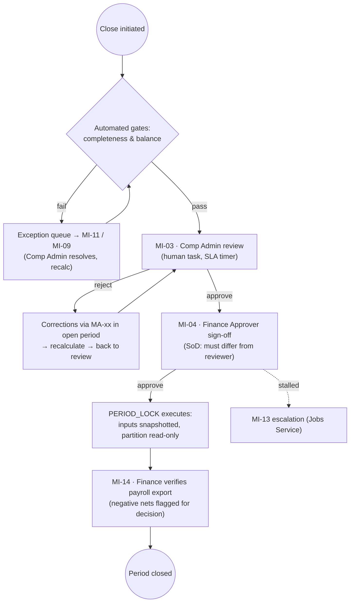
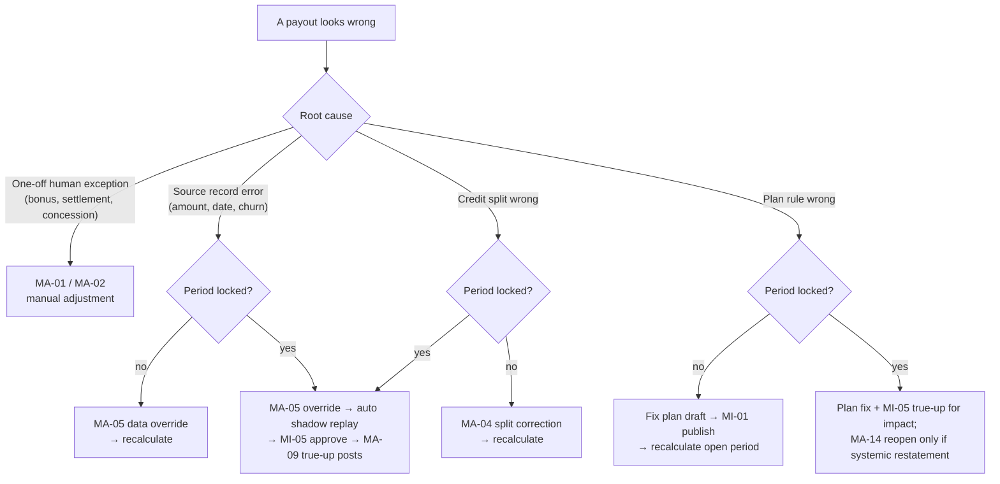

# EIM Platform — Manual Intervention & Approval Playbook

| | |
|---|---|
| **Document status** | Draft v1.0 |
| **Date** | 2026-10-28 |
| **Purpose** | Operational playbook: every point where a human must intervene, approve, or manually adjust the EIM platform — and exactly how to do it |
| **Source requirements** | [01-functional-requirements.md](01-functional-requirements.md) · [02-non-functional-requirements.md](02-non-functional-requirements.md) · [03-architecture-plan.md](03-architecture-plan.md) |
| **Audience** | Comp Admins (RevOps), Finance Approvers/Controllers, Revenue Accountants (P2), System Admins, IT/Data Engineers, on-call/hypercare |

---

## 1. Purpose & scope

The EIM platform is automation-first: ingestion, calculation, governance, and accounting run without human touch. Humans enter the loop only at **defined, audited checkpoints**. This playbook enumerates every such checkpoint and every procedure that changes money or data by hand, so that:

- operators know **when** they must act, **what** they may do, and **who** must approve;
- auditors can reconstruct any manual action end-to-end (FR-601/612/613, arch §12);
- no manual action ever bypasses the audit plane (AD-9) or mutates a locked period (FR-507, NFR-44).

Out of scope: automated system behavior (see FR doc) and infrastructure operations (deploys, DR — see arch §13 and todo TG-5).

### Intervention classes

| Class | Meaning | IDs |
|---|---|---|
| **A — Approval** | Human gates a system transition (nothing proceeds without a signature) | MI-01 … MI-10 |
| **B — Manual adjustment** | Human changes money, credit, or data by hand | MA-01 … MA-14 |
| **C — Exception handling** | Human resolves work the system blocked or flagged | MI-11 … MI-14 |
| **D — Break-glass** | Emergency procedures, always post-reviewed | MI-18 … MI-20 |
| **E — Routine human operations** | Standard human tasks, fully audited, not gating | MI-15 … MI-17 |

---

## 2. Golden rules (non-negotiable)

1. **Never edit a locked period.** All corrections to locked periods flow into the current *open* period as explicit new entries (true-ups, clawbacks, adjustments) — FR-508/FR-603. The only exception is the period-reopen break-glass (MI-18).
2. **Every manual action carries a reason code + comment.** No reason code, no commit (FR-601.1, FR-602).
3. **The original is always preserved.** Manual adjustments are *new* ledger entries linked to the original — originals are never overwritten (FR-602.1).
4. **Preparer ≠ approver.** Separation of duties applies to every approval and to every adjustment above threshold (FR-102, NFR-52).
5. **Nothing is deleted.** Reversals happen by offsetting entry; audit rows are immutable (FR-601.3, NFR-44).
6. **Approvals are processes, not checkboxes.** Every approval runs as a BPMN instance with timers, escalation, and full history (FR-621, arch §6).
7. **No direct data paths.** All changes go through the audited API/configuration registry — never direct database edits (FR-613.4).
8. **Silent recalculation is prohibited.** Manual adjustments are explicit ledger entries; they never trigger hidden recomputation of other payees' results (recalculation is a separate, visible run — FR-5xx).

---

## 3. Roles & authority matrix

| Role | May do | May NOT do |
|---|---|---|
| **Comp Admin (RevOps)** | Author plans (draft), publish plans (MI-01), resolve disputes (MI-06), enter manual adjustments (MA-01…), review quarantined data (MI-11), correct hierarchies/credits (MI-15, MA-04/05), review period close (MI-03) | Lock periods; approve own adjustments; alter accounting policy; touch audit logs |
| **Finance Approver / Controller** | Sign off & lock periods (MI-04), approve true-ups (MI-05), co-approve large adjustments (MI-07), verify & release payroll exports (MI-14), approve JEs & GL push (MI-08, P2), decide downgrade treatment (MI-10, P2), approve reopen requests (MI-18) | Author/adjust plans; approve own preparer work |
| **Revenue Accountant (P2)** | Review rollforward, classification exceptions (MI-09), propose reclasses (MA-12) | Post JEs without Controller approval |
| **System Admin** | Manage infrastructure, secrets, break-glass access (MI-19), co-approve reopen (MI-18), export audit evidence (MI-17) | See or change payout content without audit trail; bypass approval workflows outside MI-20 |
| **Payee / Manager** | Raise disputes (FR-704); view own/downline statements | Any adjustment or approval |
| **IT / Data Engineer** | Connector auth & credential rotation (MI-16), sync operations | Change mapped business data without Comp Admin review |

**Default approval threshold** (MI-07): any single manual adjustment or discretionary payment **> $10,000 USD-equivalent** (or tenant-configured amount — itself a governed config change, FR-613.2) requires Finance Approver co-approval in addition to the preparer's Comp Admin entry.

---

## 4. Master catalog — manual interventions & approvals

### Class A — Approvals (system gates)

| ID | Intervention | Actor | Trigger / gate | Workflow (BPMN) | Audit action | Ref | Phase |
|---|---|---|---|---|---|---|---|
| MI-01 | Plan publish + high-variance acknowledgement | Comp Admin | Publish gate after cycle/tier/type validation; explicit acknowledgement mandatory when cohort payout delta > configurable threshold (default 10%) | `plan-publish` (config-approval family) | `PLAN_PUBLISH` | FR-406.2/406.3 | P1 |
| MI-02 | Governed configuration approval | Category owner → approver | Activation of governed config: published plans, accounting policy, RBAC, gateway policies, workflow definitions, approval thresholds | `config-approval` | `CONFIG_CHANGE` (+ `APPROVAL`) | FR-613.2 | P1 |
| MI-03 | Period close — Comp Admin review | Comp Admin | Human task after automated completeness/balance gates pass; reviews results, adjustments, open disputes | `period-close` | `APPROVAL` | FR-605 | P1 |
| MI-04 | Period close — Finance sign-off & **lock** | Finance Approver (only role with `PERIOD_LOCK`) | Final human task before `PERIOD_LOCK` snapshots inputs and freezes the partition | `period-close` | `PERIOD_LOCK` + `APPROVAL` | FR-603/605, FR-102 | P1 |
| MI-05 | True-up review & approval | Finance Approver | Retro source changes affecting locked periods queue for review with shadow-replay diff report; posting only on approval | `true-up-review` | `APPROVAL` + `TRUEUP_POSTING` | FR-604, FR-508 | P1 |
| MI-06 | Dispute triage & resolution | Comp Admin | Payee dispute in queue; approve/reject with comments; approval enables one-click linked adjustment (MA-02) | `dispute-lifecycle` | `DISPUTE_RESOLUTION` | FR-704/705 | P1 |
| MI-07 | Adjustment co-approval above threshold | Finance Approver | Any MA-xx whose amount exceeds the configured threshold | `config-approval` variant / adjustment flow | `APPROVAL` + `MANUAL_ADJUSTMENT` | FR-602, §3 threshold | P1 |
| MI-08 | JE preview & GL push approval | Controller | Monthly accounting close: preview capitalization/amortization/impairment JEs, then approve push to ERP | `accounting-close` | `APPROVAL` + `GL_PUSH` | FR-907 | P2 |
| MI-09 | Completeness-gate exception resolution | Comp Admin + Revenue Accountant | Pre-close gate blocks when locked payouts lack classification; itemized exceptions routed for fix | `accounting-close` | `CONFIG_CHANGE` / `DATA_OVERRIDE` | FR-908/611 | P2 |
| MI-10 | Partial downgrade treatment decision | Controller | Contract contraction event: choose continue-amortizing vs pro-rata partial impairment (per policy) | `accounting-close` (event review) | `CONFIG_CHANGE` (policy application) | FR-903.2 | P2 |

### Class C — Exception handling

| ID | Intervention | Actor | Trigger | Workflow | Audit action | Ref | Phase |
|---|---|---|---|---|---|---|---|
| MI-11 | Quarantine review & reprocessing | Comp Admin | Sync rows failed validation; error log with reason + raw payload; correct then reprocess (idempotent) | `ingestion-run` | `DATA_OVERRIDE` + `CONNECTOR_RUN` | FR-203 | P1 |
| MI-12 | Parallel-run discrepancy triage | Comp Admin + design partner | Period diff report shows cent-level variance vs legacy/shadow system | parallel-run harness | `MANUAL_ADJUSTMENT` (if EIM at fault → defect, not adjustment) | NFR-06, todo TG-6 | P1 (onboarding) |
| MI-13 | Aged-item escalation handling | RevOps manager / Finance lead | Dispute or true-up exceeds SLA timer; Jobs Service escalates | per-process escalation | `APPROVAL` (reassignment) | FR-705.2, FR-621.2 | P2 |
| MI-14 | Payroll export anomaly decision | Finance Approver | Negative nets, duplicate employee numbers, or failed file generation on a locked period | export flow | `EXPORT_GENERATION` | FR-801 | P1 |

### Class D — Break-glass (emergency, always post-reviewed)

| ID | Intervention | Actors | Trigger | Controls | Audit | Ref |
|---|---|---|---|---|---|---|
| MI-18 | **Period reopen** | Finance Approver **and** System Admin (dual approval) | Material error discovered after lock that cannot be handled by true-up (e.g., wrong plan version ran; regulator requires restated statement) | Productized in P2; P1 = documented incident procedure; reopen re-snapshots, allows corrected recalc, then mandatory re-lock; all prior statements marked superseded | `PERIOD_REOPEN` + `APPROVAL` ×2 | FR-603.3 |
| MI-19 | Break-glass admin access | System Admin (named account, MFA) | Production incident requiring admin privilege | Time-boxed grant, session recorded, post-incident review ≤2 business days | `AUTH_EVENT` + audit viewer | FR-101 |
| MI-20 | Emergency config/rule hotfix | On-call engineering + incident commander | Sev-1 (e.g., payout-blocking defect) requiring config change outside normal approval | Incident ticket mandatory; change applied under incident authority; retro-active MI-02 approval within 2 business days | `CONFIG_CHANGE` (flagged `emergency`) | FR-613, arch §16 R-3 |

### Class E — Routine human operations (audited, non-gating)

| ID | Operation | Actor | Notes | Audit | Ref |
|---|---|---|---|---|---|
| MI-15 | Effective-dated hierarchy correction | Comp Admin | Manager/role changes with dates; validator rejects cycles/overlaps; if locked periods are affected → auto-routes to true-up queue (MI-05) | `CONFIG_CHANGE` (hierarchy) | FR-302, FR-604 |
| MI-16 | Connector authentication & credential rotation | IT / Data Engineer | OAuth re-consent, key-pair rotation; per-tenant keys; never stores raw secrets in config | `CONFIG_CHANGE` (connector) | FR-201, NFR-53 |
| MI-17 | Audit evidence export | System Admin / auditor (read-only) | Search & export across all three audit streams; the export itself is audited | audit-read record | FR-610 |

---

## 5. Approval workflows

### 5.1 Period close & lock (MI-03 → MI-04 → export)

### 5.2 Governed configuration approval (MI-02)

1. Preparer edits draft config (plan, accounting policy, RBAC, gateway policy, workflow definition, threshold).
2. Submit for approval → `config-approval` BPMN instance created with diff (before/after JSONB) and reason.
3. Category-designated approver reviews; optional second approver when financial impact is estimated above threshold.
4. On approval: version becomes active at its effective date; `CONFIG_CHANGE` + `APPROVAL` audit records commit in the same transaction (arch §12).
5. On rejection: draft returns to preparer; rejection reason audited.

### 5.3 Accounting close (P2 — MI-08/09/10)

Completeness gate (blocks on unclassified locked payouts) → exception resolution (MI-09) → JE preview → Controller approval (MI-08; system blocks unbalanced debits≠credits per subsidiary/currency) → GL push with retry status → ST/LT reclassification posts automatically. Downgrade events paused for Controller decision (MI-10) release before close.

---

## 6. Manual adjustment processes (MA-01 … MA-14)

> **Anatomy of every manual adjustment** (enforced by the platform, restated here as procedure):
> 1. Prepared by an authorized role in the UI — **never** via direct data access (FR-613.4).
> 2. Mandatory **reason code** (§8 taxonomy) + free-text comment; evidence attachment where indicated.
> 3. Co-approval when above threshold (MI-07) or when the specific MA requires it.
> 4. Posts as a **new ledger entry** in the **open** period, typed and linked to the original / ticket / contract; the original calculated entry remains visible.
> 5. Appears on the payee statement clearly labeled; flows into payroll totals and (P2) accounting classification.
> 6. Fully audited (`MANUAL_ADJUSTMENT` + before/after + approver chain), visible in the audit viewer (FR-610).

---

### MA-01 — Discretionary spot bonus / non-deal payment

- **Use when:** paying a one-off incentive not tied to a specific transaction (President's Club, referral bonus, contest prize).
- **Preparer / approver:** Comp Admin / Finance co-approval above threshold (MI-07).
- **Steps:** Statements → *Adjustments* → New → type `Spot bonus` → select payee(s), amount, currency, period → reason `RC-01` + comment + evidence (approval email) → submit → (co-approval if required) → posts.
- **System effect:** ledger entry `MANUAL_OVERRIDE` with `transaction_id = null`; statement line "Spot bonus"; included in payroll export.
- **Accounting note (P2):** discretionary bonuses are **not incremental** to a contract → classified *Immediate Expense* by the ASC 606 matrix (FR-901) — do not expect capitalization.
- **Limits:** never used as a substitute for a plan correction (use MA-03 or plan fix + true-up).

### MA-02 — Dispute settlement adjustment

- **Use when:** an approved dispute changes a payout (amount, split, missing deal).
- **Preparer / approver:** Comp Admin (via dispute) / dispute approval (MI-06) is the approval.
- **Steps:** open dispute ticket → *Approve & adjust* (one-click) → confirm adjustment parameters → reason auto-set `RC-02` + settlement comment → posts linked to `dispute_ticket_id` and original `ledger_id`.
- **System effect:** `MANUAL_OVERRIDE` entry linked to ticket; trace drawer on the original deal shows the dispute badge and settlement delta; ticket auto-transitions to *Adjusted*.
- **Limits:** if the dispute reveals a *systematic* plan defect, additionally fix the plan (MI-01) and evaluate true-up scope for other affected payees — do not settle identical cases one by one.

### MA-03 — Calculated-amount correction (pre-lock)

- **Use when:** a calculation input or result is wrong and the period is still **open**.
- **Preparer / approver:** Comp Admin / Finance co-approval above threshold.
- **Steps:** diagnose via trace drawer → correct the *root cause* (source data → MA-05; split → MA-04; plan → plan fix) → trigger recalculation; only if the root cause cannot be corrected (e.g., external fact) enter a manual correcting adjustment with `RC-03`/`RC-04` → recalc invalidation note.
- **System effect:** adjustment entry or corrected recalculation; statement refreshed.
- **Limits:** **preferred path is always fix-the-input + recalculate**, not hand-entry — hand-entry is the exception (Golden rule 8).

### MA-04 — Credit split reallocation

- **Use when:** deal credit was split wrongly (wrong payees or percentages).
- **Preparer / approver:** Comp Admin / Finance co-approval above threshold.
- **Steps (period open):** transaction → *Credit* → edit allocations (may total <, =, or > 100% for overlays) → reason `RC-05` + comment → recalculate affected payees (scoped run).
- **Steps (period locked):** same edit applies **now**, but effects on the locked period are computed by shadow replay and surface in the true-up queue (MI-05) for approval — the locked statement is never touched.
- **System effect:** new `credit_allocation` version (effective-dated); recalc or true-up delta; co-payee visibility updated.

### MA-05 — Raw source-data override

- **Use when:** the source record itself is wrong in EIM after ingestion (booking amount, close date, product attributes, churn flag) and cannot be corrected at the source in time.
- **Preparer / approver:** Comp Admin / Finance co-approval above threshold; source-system owner notified (the CRM remains authoritative — fix it there too).
- **Steps:** quarantined or ingested record → *Override* → corrected values + `RC-04` + evidence → reprocess.
- **System effect:** `DATA_OVERRIDE` audit with before/after; raw snapshot preserved (original never destroyed, FR-203.3); downstream recalculation (open period) or true-up (locked period).
- **Limits:** overrides are flagged on the monthly data-quality report; chronic override volume on one connector is a defect signal.

### MA-06 — Manual clawback initiation

- **Use when:** a churn/cancellation is known internally but the source flag has not arrived (e.g., offline cancellation).
- **Preparer / approver:** Comp Admin / Finance co-approval above threshold.
- **Steps:** transaction → *Flag churn/cancel* → effective date + `RC-06` + evidence (email, order form) → engine validates the clawback window → negative offsetting entry generated in the open period.
- **System effect:** `CLAWBACK` entry referencing the original; (P2) deferred-asset balance reduced and any unamortized remainder impaired per FR-903.1 automatically on the accounting side.
- **Limits:** only within the plan's clawback window; outside it, use MA-13 rationale via Finance.

### MA-07 — Draw adjustment (advance / recovery forgiveness)

- **Use when:** adjusting a draw — extra advance mid-period, or forgiving a recoverable-draw deficit (e.g., territory change fairness).
- **Preparer / approver:** Comp Admin prepares; **deficit forgiveness always requires Finance Approver** (it is a payment commitment), advances above threshold co-approved (MI-07).
- **Steps:** payee → *Draw* → adjust advance or forgive deficit → `RC-07` + rationale → posts.
- **System effect:** `DRAW_ADVANCE` or draw-recovery waiver entry; draw state machine's carried-forward deficit updated (FR-504); future recoveries recalculated.
- **Limits:** forgiveness is visible on the payee's statement as a resolved draw; never net silently against future periods without an entry.

### MA-08 — Quota / plan-assignment exception (mid-period)

- **Use when:** an individual quota or assignment exception is needed mid-period (leave, territory gap, negotiated target).
- **Preparer / approver:** Comp Admin / Finance Approver (quota changes affect liability).
- **Steps:** payee → *Assignment* → new effective-dated assignment (never overwrite history) with proration preview → `RC-08` + approval reference → engine segments the period (FR-506) and prorates quota by active days.
- **System effect:** effective-dated `plan_assignment`; sub-period segmentation at next calculation; statements show prorated targets.
- **Limits:** changes with retroactive effective dates into locked periods route to true-up (MI-05), never edit history.

### MA-09 — True-up posting (approved retro delta)

- **Use when:** the engine's shadow replay produced deltas for a locked period (late deal, corrected amount, hierarchy change) — MI-05 approval completes the flow.
- **Preparer / approver:** system proposes; **Finance Approver approves** (MI-05).
- **Steps:** true-up queue → review diff report (per payee/component, ripple effects included) → approve or reject (reason required) → on approve, `PRIOR_PERIOD_TRUEUP` entries post in the open period with `origin_period_id`.
- **System effect:** statements render the purple origin badge with original-vs-adjusted diff (FR-702.4); payroll totals include the delta; (P2) accounting posts catch-up amortization on the child stream (FR-903.3).
- **Limits:** reject-and-recheck is free — approval is the point of no return for the open period.

### MA-10 — Payroll hold / off-cycle handling

- **Use when:** an amount must be held from a payroll file (dispute pending, termination processing) or paid off-cycle after a file was released.
- **Preparer / approver:** Finance Approver (both directions).
- **Steps:** export preview → *Hold* on the payee line with reason → file regenerates (byte-identical for non-held lines); off-cycle: create off-cycle export batch with `RC-02`/`RC-04` linkage → separate file + audit.
- **System effect:** `EXPORT_GENERATION` for each file; held amounts remain accrued on the ledger; off-cycle entries marked `off_cycle=true` in export metadata.
- **Limits:** holds never delete ledger entries; the accrual stays until released.

### MA-11 — Corporate FX rate table update *(P2)*

- **Use when:** loading daily/monthly corporate rates used at ingestion and capitalization.
- **Preparer / approver:** Revenue Accountant/Finance ops prepares rate file; Controller approves table activation (governed config, MI-02).
- **Steps:** upload rates (currency pair, date, rate to 6 dp) → validation (no gaps for active currencies) → approve → active from effective date.
- **System effect:** new transactions/rate applications use the table; **already-capitalized assets never revalue** (historical lock, FR-905) — the table is forward-only.
- **Limits:** backdated rate entries affecting locked periods require true-up review, not direct restatement.

### MA-12 — ASC 606 classification override *(P2)*

- **Use when:** a specific ledger entry/asset was misclassified (e.g., a "pooled spiff" that was actually strictly formulaic per deal).
- **Preparer / approver:** Revenue Accountant proposes; Controller approves (MI-08 chain).
- **Steps:** asset/entry → *Reclassify* → target treatment (capitalize/expense + basis) → `RC-10` + memo → approval.
- **System effect:** prospectively reclassified per accounting policy rules; previously **posted** schedule lines are never overwritten — an explicit adjustment event carries the change (FR-909, NFR-62); rollforward shows the reclass line.
- **Limits:** policy-level changes (whole cost types) go through policy config approval (MI-02), not per-entry overrides.

### MA-13 — Manual impairment entry *(P2)*

- **Use when:** writing off an unamortized deferred asset outside automated churn handling (e.g., customer bankruptcy not yet flagged as churn, MI-10 downgrade decision executed manually).
- **Preparer / approver:** Revenue Accountant prepares; Controller approves (MI-08).
- **Steps:** asset → *Impair* → effective date, amount (≤ unamortized balance), `RC-11` + evidence → posts impairment JE; future schedule lines zeroed.
- **System effect:** impairment entry + rollforward line; contract linkage retained for audit.
- **Limits:** blocked if it would hit a **closed accounting period** — rolls to next open period as catch-up (FR-907.3).

### MA-14 — Locked-period correction via reopen *(P2, exceptional)*

- **Use when:** the material-error test passes — the error is systemic (wrong plan version, wrong population), true-up is inadequate (e.g., statements must be re-issued as-if correct), and Finance leadership agrees restatement is required.
- **Preparer / approver:** Finance Approver **and** System Admin (dual, MI-18); payroll/provider notification required if funds moved.
- **Steps:** reopen request with impact memo → dual approval → period reopens (snapshot preserved) → corrected inputs/plan → recalculate → re-run close (MI-03/04) → re-lock → superseded statements marked; payees notified of restatement.
- **System effect:** `PERIOD_REOPEN` + full before/after chain; original locked snapshot retained for comparison forever.
- **Limits:** expected frequency ≈ zero; every occurrence triggers a post-incident review and a defect/cause entry in the monthly data-quality report.

---

## 7. Decision guide — "a number looks wrong"

---

## 8. Reason-code taxonomy (mandatory on every adjustment)

| Code | Meaning | Typical MA | Extra approval |
|---|---|---|---|
| RC-01 `SPOT_BONUS` | Discretionary one-off payment | MA-01 | MI-07 above threshold |
| RC-02 `DISPUTE_SETTLED` | Settlement of approved dispute | MA-02, MA-10 | MI-06 (the dispute approval) |
| RC-03 `PLAN_ERROR` | Plan/rate misconfiguration consequence | MA-03 | Finance |
| RC-04 `DATA_ERROR` | Corrected source data | MA-03, MA-05, MA-10 | MI-07 above threshold |
| RC-05 `CREDIT_CORRECTION` | Credit/split fix | MA-04 | MI-07 above threshold |
| RC-06 `CLAWBACK_MANUAL` | Manually initiated clawback | MA-06 | Finance |
| RC-07 `DRAW_ADJUST` | Draw advance / forgiveness | MA-07 | Forgiveness: always Finance |
| RC-08 `QUOTA_EXCEPTION` | Mid-period quota/assignment exception | MA-08 | Finance |
| RC-09 `FX_RATE_UPDATE` | Corporate rate table change | MA-11 | Controller (MI-02) |
| RC-10 `ACCT_RECLASS` | ASC 606 classification override | MA-12 | Controller |
| RC-11 `IMPAIRMENT_MANUAL` | Manual impairment | MA-13 | Controller |
| RC-12 `REOPEN_CORRECTION` | Correction executed via reopen | MA-14 | Dual (MI-18) |
| RC-99 `OTHER` | None of the above | any | **Finance Approver always** + mandatory free-text detail |

---

## 9. SLA & escalation defaults (tenant-configurable via governed config)

| Intervention | Default SLA | Escalation on breach |
|---|---|---|
| MI-11 quarantine review | 1 business day | Daily digest → Comp Admin's manager |
| MI-06 dispute first response | 2 business days | RevOps manager (P2: Jobs Service timer, FR-705.2) |
| MI-06 dispute resolution | 5 business days | Finance Approver + payee notification |
| MI-05 true-up review | Before open-period close (≥2 business days pre-close) | Finance lead |
| MI-03/04 period close steps | Whole close <3 business days (P1 target; <2 from P2) | Finance leadership |
| MI-02 config approval | 3 business days | Auto-escalate to System Admin |
| MI-07 co-approval | 1 business day | Finance lead |
| MI-08/09 accounting close exceptions | 2 business days | Controller |
| MI-18/19/20 break-glass review | Post-incident review ≤2 business days | Security/Finance leadership |

---

## 10. Break-glass procedures (summary)

- **MI-18 Period reopen:** impact memo → Finance Approver + System Admin dual approval (two distinct humans, both authenticated via SSO — never break-glass accounts) → reopen → correct → re-close → re-lock → restatement notices. Every artifact (memo, approvals, before/after ledgers) retained on the audit trail.
- **MI-19 Break-glass access:** named MFA account only; grant is time-boxed; all sessions recorded; usage outside a declared incident is a security event (NFR-55).
- **MI-20 Emergency hotfix:** incident ticket number mandatory in the change; `emergency` flag on the `CONFIG_CHANGE` audit record; retro-approval (MI-02) within 2 business days or the change auto-reverts (policy configurable).

---

## 11. Audit expectations — what gets recorded for each playbook entry

| Playbook entries | Audit action type(s) | Key fields captured |
|---|---|---|
| MI-01 | `PLAN_PUBLISH` | plan_version_hash, cohort delta, high-variance acknowledgement |
| MI-02, MI-15, MI-16, MA-08 | `CONFIG_CHANGE` (+`APPROVAL`) | before/after JSONB, reason, approver chain, effective dates |
| MI-03, MI-04 (sign-off), MI-05, MI-06, MI-07 | `APPROVAL` | process instance, task, actor, timestamps, decision, comment |
| MI-04 (lock) | `PERIOD_LOCK` | period, snapshot reference |
| MI-18 | `PERIOD_REOPEN` + `APPROVAL` ×2 | dual approvers, impact memo reference |
| All MA-xx | `MANUAL_ADJUSTMENT` | reason code + comment, before/after, links (ticket/contract/original entry), approver |
| MA-05 | `DATA_OVERRIDE` | record, before/after, raw snapshot ref |
| MA-09 | `TRUEUP_POSTING` | origin_period_id, diff summary |
| MI-08/MA-12/MA-13 | `APPROVAL` + `GL_PUSH` | JE batch, balance check result |
| MI-14 | `EXPORT_GENERATION` | file hash, held lines, off-cycle flag |
| MI-19/MI-20 | `AUTH_EVENT` / `CONFIG_CHANGE(emergency)` | incident reference, grant window |

Every row is queryable in the audit viewer (FR-610), sealed daily (NFR-60), and reconciled for completeness (NFR-64).

---

## 12. Quick reference card

- **Money changes hands only via:** MA-01…MA-14 — always open period, always reason-coded, always audited, co-approved above $10k (default).
- **Lock is one-way:** corrections after lock = true-up (MI-05 → MA-09); reopen (MI-18) is a dual-approved exception.
- **Preparer never approves.** Comp Admin builds; Finance signs.
- **Fix inputs before hand-entering numbers.** Hand adjustments are the last resort, not the first tool.
- **Disputes ride the process.** Never adjust outside the dispute flow when a rep raised one.
- **When in doubt:** check the decision guide (§7), then the audit viewer — if you cannot explain the adjustment as a reason code, it is not an adjustment; it is a defect ticket.

---

*Companion to the requirements and architecture documents; operationalizes FR-2xx/4xx/5xx/6xx/7xx/8xx/9xx human touchpoints and arch §6/§12. Update alongside any change to approval workflows or reason codes (both are governed configuration, FR-613).*
