# EIM Platform — Build TODO & Tollgate Plan

| | |
|---|---|
| **Document status** | Living document — update as work completes |
| **Date** | 2026-10-28 |
| **Source requirements** | [01-functional-requirements.md](doc/01-functional-requirements.md) · [02-non-functional-requirements.md](doc/02-non-functional-requirements.md) · [03-architecture-plan.md](doc/03-architecture-plan.md) |
| **Conventions** | `- [ ]` open · `- [x]` done · ⛔ blocked (note why) · every item traces to FR-xxx / NFR-xx / arch § |

---

## 1. How to use this plan

- Work is organized into **tollgates (TG-0 … TG-8)**. A tollgate is a formal checkpoint: its **Exit criteria** must be demonstrably met (evidence linked) before the next gate starts.
- Inside each tollgate, items are grouped by **workstream category** with stable IDs (`TG3-CAL-4`), so items can be referenced from tickets, PRs, and standups.
- **Nothing changes unaudited** (AD-9): the audit plane items in TG-0/TG-1 are *prerequisites*, not afterthoughts — from the first line of code, every endpoint and event type declares its audit mapping (NFR-64), or CI fails.
- Phases map to the roadmap: TG-0…TG-6 = Phase 1 MVP (months 1–6, per the PRD rollout plan), TG-7 = Phase 2 (months 7–12), TG-8 = Phase 3 (months 13–18).
- The **Continuous verification** section (§3) is not a tollgate — those activities run forever once their tooling is built.

### Tollgate flow

```mermaid
flowchart LR
    TG0["TG-0 Program setup"] --> TG1["TG-1 Platform foundation<br/>& security baseline"]
    TG1 --> TG2["TG-2 Data ingestion &<br/>credit / hierarchy"]
    TG2 --> TG3["TG-3 Plan modeling &<br/>calculation engine"]
    TG3 --> TG4["TG-4 Governance &<br/>seller portal"]
    TG4 --> TG5["TG-5 Hardening &<br/>release readiness"]
    TG5 --> TG6["TG-6 Parallel run<br/>& Phase 1 GA"]
    TG6 --> TG7["TG-7 Phase 2:<br/>accounting & enterprise"]
    TG7 --> TG8["TG-8 Phase 3:<br/>SPM & channel"]
```

> TG-1 and TG-2 both anchor to PRD months 1–2 and may run in parallel once TG-1's data-plane items (schema, AGE, Kafka) land.

### Workstream category codes

| Code | Workstream | Code | Workstream |
|---|---|---|---|
| INF | Infrastructure & platform (K8s, operators) | UI | Frontend (eim-web) |
| SEC | Security & identity | PRC | Process automation (Kogito BPMN) |
| AUD | Audit plane (outbox, interceptors, seals) | GOV | Governance (lock, overrides, approvals) |
| DAT | Data schema & graph (PostgreSQL + AGE) | SEL | Seller experience |
| ING | Ingestion & connectors | EXP | Exports & ERP |
| HIE | Hierarchy & credit assignment | TST | Testing & verification |
| RUL | Rule & decision layer (Drools DRL/DMN) | OPS | Operations, DR, runbooks |
| CAL | Calculation engine | ONB | Design-partner / customer onboarding |
| | | ACC | Accounting module (Phase 2) |

### Progress overview

| Gate | Name | Anchor | Target window | Status |
|---|---|---|---|---|
| TG-0 | Program setup | Pre-development | Week 0–2 | ☐ Not started |
| TG-1 | Platform foundation & security baseline | PRD months 1–2 | Month 1 | ☐ Not started |
| TG-2 | Data ingestion & credit/hierarchy | PRD months 1–2 | Months 1–2 | ☐ Not started |
| TG-3 | Plan modeling & calculation engine | PRD months 3–4 | Months 3–4 | ☐ Not started |
| TG-4 | Governance & seller portal | PRD month 5 | Month 5 | ☐ Not started |
| TG-5 | Hardening & release readiness | Pre-parallel-run | Month 6 (first half) | ☐ Not started |
| TG-6 | Parallel run & Phase 1 GA | PRD month 6 | Month 6 | ☐ Not started |
| TG-7 | Phase 2 — accounting & enterprise | Months 7–12 | Months 7–12 | ☐ Not started |
| TG-8 | Phase 3 — SPM & channel | Months 13–18 | Months 13–18 | ☐ Not started |

---

## TG-0 — Program setup *(pre-development, weeks 0–2)*

**Objective**: repositories, toolchains, and guardrails such that every later merge is born compliant (types, tests, audit mapping, portability).

### 0.1 Repositories & toolchain (INF)

- [ ] **TG0-INF-1** Create service repositories / monorepo layout: `eim-web` (pnpm + Turborepo: `web-app`, `ui-kit`, `api-client`, `schemas`, `shared-domain`), `eim-core-api`, `eim-connectors`, `eim-calc-engine`, `eim-process`, `eim-plan-compiler`, `helm/eim-platform` umbrella chart (arch §4, §10)
- [ ] **TG0-INF-2** Backend service skeletons (Quarkus) with OTel SDK, health probes, Flyway wired (NFR-90, arch §13.2)
- [ ] **TG0-INF-3** Local dev environment: kind/k3s cluster script booting PostgreSQL+AGE, Kafka, MinIO, APISIX, Keycloak via the same Helm charts (NFR-80 dev target)
- [ ] **TG0-INF-4** OpenAPI 3.1 spec scaffolding per service + lint (spectral) in CI (NFR-101)
- [ ] **TG0-INF-5** Frontend codegen pipeline: OpenAPI → `openapi-typescript`/hey-api client + Zod schema generation; freshness check fails CI on spec drift (AD-5, NFR-103)

### 0.2 Guardrails in CI (TST)

- [ ] **TG0-TST-1** TypeScript strictness gates: `strict`, `noUncheckedIndexedAccess`, `exactOptionalPropertyTypes`, `noImplicitOverride`; typed ESLint (strict-type-checked); `tsc --noEmit` gate (NFR-103)
- [ ] **TG0-TST-2** Coverage floors in CI: ≥85% lines on calc/ledger/amortization modules, ≥70% elsewhere (NFR-102)
- [ ] **TG0-TST-3** Float-prohibition static rule for calculation modules (NFR-01)
- [ ] **TG0-TST-4** Golden-test harness skeleton (versioned fixtures + diff approval flow) (NFR-100)
- [ ] **TG0-TST-5** Consumer-contract test harness between frontend/api-client and services (NFR-101)
- [ ] **TG0-TST-6** **Audit-coverage CI suite**: framework requiring every new endpoint & event type to declare its audit mapping, else build fails (NFR-64, AD-9)

### 0.3 Portability & delivery guardrails (INF)

- [ ] **TG0-INF-6** Helm chart lint + `helm template` substitution-matrix job (CloudNativePG ↔ external PG via values only) (NFR-81)
- [ ] **TG0-INF-7** Image pipeline: distro-style minimal JDK/Node images, SBOM (syft), CVE scan gate blocking criticals (NFR-57)
- [ ] **TG0-INF-8** GitOps skeleton: Argo CD app-of-apps, dev/staging/prod overlays, digest-pinned promotions (arch §13.2)

### 0.4 Ways of working (OPS)

- [ ] **TG0-OPS-1** ADR process seeded; ratify AD-1…AD-9 from the architecture plan (NFR-105, arch §2)
- [ ] **TG0-OPS-2** Definition of Done includes: tests, contract updated, audit mapping declared, runbook entry for any new alert (NFR-64/93)
- [ ] **TG0-OPS-3** Threat model workshop + security requirements checklist (OWASP API Top 10, BOLA focus) (NFR-54)
- [ ] **TG0-OPS-4** Onboarding docs: service READMEs, local-run instructions, first-contribution path <2 days (NFR-105)

**Exit criteria TG-0**: CI pipeline enforces types/tests/coverage/audit-mapping/chart-lint on a hello-world change; `k3s up` script boots the full platform from one umbrella chart; ADRs 1–9 merged.

---

## TG-1 — Platform foundation & security baseline *(month 1; PRD months 1–2)*

**Objective**: the platform everything else runs on — data plane, identity, gateway, observability, and the **audit plane** — live and verified.

### 1.1 Data plane (INF/DAT)

- [ ] **TG1-INF-1** CloudNativePG: PostgreSQL 16 HA (1 primary + 2 replicas) with **AGE custom image**; WAL archiving + encrypted backups (NFR-42/50, arch §13.1)
- [ ] **TG1-INF-2** Strimzi Kafka (3 brokers, KRaft) + topic-creation conventions (`eim.*`, per-tenant quotas) (AD-7, NFR-33)
- [ ] **TG1-INF-3** MinIO tenant (erasure-coded) + bucket layout: snapshots, statements, attachments, exports (arch §4)
- [ ] **TG1-DAT-1** Flyway migrations: `payee`, `plan_assignment`, `comp_plan`/`plan_version`, `raw_transaction`, `credit_allocation`, `payout_period`, `dispute_ticket` (FR §12 schema, types enforced by migration tests)
- [ ] **TG1-DAT-2** `commission_ledger_entry` declarative partitioning by payout period + partition maintenance job + locked-partition privilege drop (NFR-31/44, FR-507)
- [ ] **TG1-DAT-3** RLS policies keyed on `app.current_tenant_id` / `app.current_payee_id`; service-layer session-variable injection from JWT claims (FR-103, NFR-52)
- [ ] **TG1-DAT-4** AGE graph `eim_graph` per tenant: `MANAGES_OF`, `CREDITED_TO`, `DEPENDS_ON` label tables + projection writers + graph↔table reconciliation job with drift alerts (AD-3, arch §9.2, NFR-93)
- [ ] **TG1-DAT-5** Expand/contract migration policy lint in CI (no destructive step in release scope) (NFR-41)

### 1.2 Identity, gateway & security (SEC)

- [ ] **TG1-SEC-1** Keycloak: OIDC + SAML 2.0 brokering to customer IdPs; JWT claims `tenant/roles/payee_id`; SCIM 2.0 provisioning; break-glass MFA admin (FR-101, FR-104)
- [ ] **TG1-SEC-2** APISIX + Ingress Controller as sole edge: `openid-connect` JWT validation, tenant consumer abstraction + rate limits, request-size/schema limits, mTLS termination (FR-101/102, NFR-51/54)
- [ ] **TG1-SEC-3** RBAC roles (System Admin, Comp Admin, Finance Approver, Payee, Manager) + SoD matrix — `PERIOD_LOCK` exclusive to Finance Approver (FR-102)
- [ ] **TG1-SEC-4** Secrets: external-secrets operator; per-tenant encryption keys for connector credentials; image/pipeline secret scanning (NFR-53)
- [ ] **TG1-SEC-5** TLS 1.3 everywhere; AES-256 at rest verification (PG, MinIO, backups) (NFR-50)
- [ ] **TG1-SEC-6** mTLS service-to-service (mesh or APISIX upstream mTLS); no workload reachable except via gateway (NFR-51)

### 1.3 Audit plane — build first, not last (AUD)

- [ ] **TG1-AUD-1** `transactional_outbox` infrastructure + exporter service (business rows + audit + outbox in one transaction; exporter drains to Kafka) (FR-601.4, arch §12.2)
- [ ] **TG1-AUD-2** Audit interceptor library wired into `eim-core-api` skeleton: actor/actor-type, correlation ID, before/after JSONB, source, outcome (FR-601.1)
- [ ] **TG1-AUD-3** `audit_log`, `event_audit_log`, `configuration_change` stores; append-only DB privileges (tamper attempt fails) (FR-601.3, NFR-60)
- [ ] **TG1-AUD-4** Event auditor consumer: every Kafka event persisted with payload + hash + schema version; consumer outcome tracking incl. dead-letter (FR-612.1/612.2)
- [ ] **TG1-AUD-5** Config registry: all runtime config via versioned APIs → `configuration_change`; governed-category approval gating hooks (FR-613.1/613.2)
- [ ] **TG1-AUD-6** Daily hash-chain sealer job + seal-verification tool (NFR-60)
- [ ] **TG1-AUD-7** Gateway-issued correlation ID propagation into every service (NFR-90, FR-612)
- [ ] **TG1-AUD-8** Argo CD sync watcher mirroring GitOps config (APISIX routes, chart values) into `configuration_change` (FR-613.5)
- [ ] **TG1-AUD-9** Runtime reconciliation job: mutation vs event vs audit counts, gap alerting (NFR-64)

### 1.4 Observability baseline (OPS)

- [ ] **TG1-OPS-1** OTel collector + Prometheus/Grafana/Loki/Tempo deployment via Helm (arch §14)
- [ ] **TG1-OPS-2** Tracing end-to-end on the skeleton path: gateway → service → DB with unbroken span tree check in staging (NFR-90)
- [ ] **TG1-OPS-3** RED metrics per service + structured JSON logs with tenant/correlation IDs; PII/amount log policy enforced by lint (NFR-91/92)
- [ ] **TG1-OPS-4** Alert routing + runbook template; every shipped alert links a runbook (NFR-93)

**Exit criteria TG-1**: (1) SSO login through APISIX hits an RLS-protected read-only page; (2) a scripted mutation shows its audit record, outbox event, and event-audit entry committed atomically; (3) tamper attempt on each audit store fails; (4) full stack deploys from the umbrella chart on two different providers + k3s (NFR-80 smoke evidence).

---

## TG-2 — Data ingestion & credit/hierarchy *(months 1–2)*

**Objective**: clean, auditable data in; credits and effective-dated hierarchies correct.

### 2.1 Connector framework (ING)

- [ ] **TG2-ING-1** Connector runtime: scheduled/on-demand jobs, run history, counts (total/accepted/quarantined), retry semantics, per-tenant quotas (FR-201.2, NFR-33)
- [ ] **TG2-ING-2** Salesforce connector: OAuth 2.0 connect <3 min, Opportunity/Line Item/User objects, incremental watermark sync (FR-201.1, FR-204.1)
- [ ] **TG2-ING-3** HubSpot connector (OAuth, equivalents of above) (FR-201.1)
- [ ] **TG2-ING-4** Snowflake connector: key-pair auth, read-only, table/view mapping (FR-201.1)
- [ ] **TG2-ING-5** CSV/XLSX upload: schema validation, row-level errors, re-processing idempotency (FR-201.1, FR-203.2)
- [ ] **TG2-ING-6** Field-mapping UI + type coercion validation rejecting unmappable required fields pre-sync; `custom_attributes` JSONB mapping without migrations (FR-202)
- [ ] **TG2-ING-7** Schema validation & quarantine: error log with reason + raw payload; valid rows commit; quarantined reprocessing idempotent (FR-203)
- [ ] **TG2-ING-8** Raw source snapshots to MinIO, immutable, batch lineage (`ingestion_batch_id`) (FR-203.3)
- [ ] **TG2-ING-9** Late-arriving change detection on already-processed periods → `eim.trueup.required` events (FR-204.2, FR-604)
- [ ] **TG2-ING-10** `ingestion-run` BPMN process in Kogito (run, validation report, retro-change branching) (FR-621, arch §6.1)
- [ ] **TG2-ING-11** Every connector run + every connector config change audited (FR-612.4, FR-613)

### 2.2 Credit & hierarchy (HIE)

- [ ] **TG2-HIE-1** Credit splits: percentage allocations ≤/=/>100%, overlay crediting, per-payee lineage; co-payee visibility data (FR-301, FR-702.3)
- [ ] **TG2-HIE-2** Effective-dated payee/hierarchy admin (SCD 2): role, manager, plan assignment with date ranges (FR-302)
- [ ] **TG2-HIE-3** Hierarchy validator: cycle + impossible-overlap rejection at save (FR-302.2, arch §9.3)
- [ ] **TG2-HIE-4** AGE rollup resolution as-of date + benchmark <2 s @ 5,000 payees in CI (FR-303, NFR-24)
- [ ] **TG2-HIE-5** Wavefront layering query (longest-path depth) for the calc engine (FR-503, arch §9.3)
- [ ] **TG2-HIE-6** Mid-period manager-move scenario test (May 14/15 split rolls to X then Y — automatic) (FR-302.1)
- [ ] **TG2-HIE-7** Design-partner historical backfill tooling (2+ periods of CRM + hierarchy snapshots) — feeds TG-6 parallel run

**Exit criteria TG-2**: two consecutive clean automated syncs (SFDC + CSV) into the canonical model with quarantine reports; as-of hierarchy queries verified against fixture orgs; every sync batch and hierarchy edit carries audit + event records; reconciliation job shows zero gaps.

---

## TG-3 — Plan modeling & calculation engine *(months 3–4)*

**Objective**: the deterministic numeric core plus the no-code builder that feeds it — the heart of the product.

### 3.1 Rule & decision layer (RUL)

- [ ] **TG3-RUL-1** Plan DSL & AST: typed components/parameters; real-time type checker (Currency/Percent/Decimal/Boolean/Date) (FR-401, FR-402.2)
- [ ] **TG3-RUL-2** Tarjan SCC dependency-cycle detection at publish; hierarchy cycle check integrated (FR-406.1)
- [ ] **TG3-RUL-3** DRL generation (forward-chaining rules) with compiler-controlled salience/ordering for deterministic firing (arch §5.1, NFR-08)
- [ ] **TG3-RUL-4** Backward-chaining DRL queries for explanation/goal derivation (dispute triage pre-tagging: `SOURCE_DATA/CREDIT_SPLIT/WINDOW_STATE/PLAN_LOGIC`) (FR-704.1, arch §5.1)
- [ ] **TG3-RUL-5** DMN generation for tier tables + decision-table completeness/consistency verification in the publish pipeline (FR-403, NFR-104)
- [ ] **TG3-RUL-6** Artifact registry: immutable versioned DRL/DMN + `plan_version_hash`; multiple versions coexist (FR-406, NFR-62, arch §5.2)
- [ ] **TG3-RUL-7** KIE test-harness unit tests for all generated artifacts (NFR-104)

### 3.2 Calculation engine (CAL)

- [ ] **TG3-CAL-1** Precision utilities: BigDecimal (DECIMAL128 semantics) money/rate types, single-point rounding (HALF_EVEN default / HALF_UP), mutation-tested (NFR-01/02)
- [ ] **TG3-CAL-2** Deterministic sort key `(transaction_date, source_ts_utc, transaction_uuid)`; repeat-run differential tests (FR-501, NFR-03)
- [ ] **TG3-CAL-3** Stateful accumulation windows (metric, reset cadence, order-by) with window state exposed to traces (FR-404)
- [ ] **TG3-CAL-4** Marginal tier slicing via interval intersection + cliff mode; **canonical 3-slice case permanent test** ($90k + $70k → $10,500.00) (FR-502)
- [ ] **TG3-CAL-5** Wavefront scheduler: AGE-resolved levels, parallel payee sub-graphs, manager-wave barrier; atomic-or-clean rollback on worker failure (FR-503, NFR-04)
- [ ] **TG3-CAL-6** Draws state machine: recoverable/non-recoverable, carry-forward deficit, recovery deduction, typed entries (FR-504)
- [ ] **TG3-CAL-7** Caps (period/annual, amount/%) with capped residual in trace (FR-405.3)
- [ ] **TG3-CAL-8** Clawbacks: churn-flag trigger within window, negative entries in open period, partial proration, origin linkage (FR-505)
- [ ] **TG3-CAL-9** Mid-period proration/segmentation: plan & hierarchy splits, active-days quota proration, transaction routing by date (FR-506)
- [ ] **TG3-CAL-10** Manager rollup components over wavefront outputs (FR-303, FR-503)
- [ ] **TG3-CAL-11** Atomic ledger commit: single transaction per run, partitioned writes, immutable entries + typed `entry_type` (FR-507.1/507.3)
- [ ] **TG3-CAL-12** `calculation_trace` JSONB emission (all mandatory fields, ≤16 KB compressed) + invariant check failing runs on missing/oversized trace (FR-507.2, NFR-07)
- [ ] **TG3-CAL-13** Bi-temporal shadow replay: frozen-input load as-of lock, pinned historical artifacts, set-diff on `(payee, transaction, component)`, `PRIOR_PERIOD_TRUEUP` emission with `origin_period_id` (FR-508)
- [ ] **TG3-CAL-14** `calc.run` orchestration: Kogito service tasks + Kafka `calc.run.requested/completed`; KEDA autoscaling on topic lag (arch §7.1/§7.3, NFR-30)
- [ ] **TG3-CAL-15** Nightly 500 payees × 100k benchmark vs 15 s budget with 20% regression alert (NFR-20)

### 3.3 No-code plan builder UI (UI)

- [ ] **TG3-UI-1** Split-canvas builder: component tree, parameter panel, formula bar with `@`/`$` autocomplete, token type-coloring, inline type-error underlines with fix suggestions (FR-401/402)
- [ ] **TG3-UI-2** Rate-table grid: marginal/cliff toggle with visual threshold explanation, contiguity enforcement & boundary healing, % or absolute basis, CSV tier import (FR-403)
- [ ] **TG3-UI-3** Protections editor: draws, caps, clawback windows (FR-405)
- [ ] **TG3-UI-4** Live sandbox preview dock: payee/period selector, deal-by-deal outputs, delta vs published version, **<800 ms** for scoped changes, labeled synthetic test deals never persisted (FR-407, NFR-23)
- [ ] **TG3-UI-5** Publish gate UI: validation results (cycles, tier gaps, decimal safety), cohort payout diff, high-variance warning >10% requiring acknowledgement (FR-406.2/406.3)
- [ ] **TG3-UI-6** Keyboard-first grid UX: Tab/Shift+Tab, Enter-commit, undo history, ⌘K command palette (NFR-120)
- [ ] **TG3-UI-7** Frontend perf budgets in CI (Lighthouse/Web-Vitals: FCP <2 s, interactive <3.5 s; virtualized 10k-row grids) (NFR-26)
- [ ] **TG3-UI-8** Redis dirty-flag preview cache: `(ast_hash, inputs_hash)` scoped by AGE `DEPENDS_ON` sub-graph; correctness never depends on cache (FR-509, arch §7.2)

### 3.4 Verification (TST)

- [ ] **TG3-TST-1** Golden calculation suites covering every FR-5xx feature incl. rounding boundaries; golden-file change requires approval (NFR-100)
- [ ] **TG3-TST-2** Determinism suite: replay versioned fixtures → byte-identical ledger + trace (NFR-03)
- [ ] **TG3-TST-3** Fault injection: kill workers mid-wave → no partial commits (NFR-04, FR-503.3)

**Exit criteria TG-3**: golden suites green incl. canonical marginal case; nightly benchmark ≤15 s on reference sizing; preview p95 <800 ms; publish produces immutable versioned artifacts; audit records exist for every plan version and calculation run.

---

## TG-4 — Governance & seller portal *(month 5)*

**Objective**: Finance controls, seller transparency, and the exports that close the pay cycle.

### 4.1 Governance (GOV/PRC)

- [ ] **TG4-GOV-1** Manual adjustment overrides: separate entry type, original preserved, mandatory reason code/comment, dispute linkage (FR-602, FR-601.1)
- [ ] **TG4-GOV-2** `period-close` BPMN: completeness/balance gates → Comp Admin review → Finance sign-off (SoD) → `PERIOD_LOCK` service task (input snapshot + partition read-only) → export handoff → notifications; stall timers via Jobs Service (FR-603/605, arch §6.2)
- [ ] **TG4-GOV-3** True-up queue + `true-up-review` process: diff reports, Finance approval, re-check, posting of true-up entries (FR-604)
- [ ] **TG4-GOV-4** Audit viewer: search all three streams (actor, entity, type, config category, correlation ID, date range), CSV/JSON export; audit-read itself audited (FR-610)
- [ ] **TG4-GOV-5** Retro-CRM-change → automatic true-up routing regression tests (FR-604.1, FR-508)
- [ ] **TG4-GOV-6** Degradation behavior: statements served read-only during engine outage; ingestion buffers (NFR-43)

### 4.2 Seller experience (SEL)

- [ ] **TG4-SEL-1** Statement overview: total payout, attainment thermometer + next-tier hurdle, component breakdown (base/spiffs/draws/true-ups), open vs locked states, filters (period/deal/product) (FR-701)
- [ ] **TG4-SEL-2** Calculation trace drawer: 3-step layout (split → window position with tier ticks → marginal slice cards) bound directly to JSONB, hover slice↔bar linkage, co-payee notes, true-up origin badge + original-vs-adjusted diff (FR-702)
- [ ] **TG4-SEL-3** Statement PDF/CSV download matching on-screen values (FR-703)
- [ ] **TG4-SEL-4** Dispute submission: 4 structured categories, notes, attachments; pre-tagged `ledger_id/transaction_id/node category` via backward-chaining query (FR-704)
- [ ] **TG4-SEL-5** `dispute-lifecycle` BPMN: queue + notification, approve/reject with comments, one-click adjustment linked to ticket, full lifecycle audit (FR-705, FR-621)
- [ ] **TG4-SEL-6** Accessibility & typography: WCAG 2.1 AA (axe-core CI + screen-reader passes), `tabular-nums`, color-independent negative semantics (NFR-73/121/122)

### 4.3 Exports (EXP)

- [ ] **TG4-EXP-1** Payroll export: customizable CSV templates (ADP, Workday, NetSuite journal summary), one net line per payee by `employee_number`, negative-net flagging, file-hash logging, byte-identical regeneration for locked periods (FR-801)
- [ ] **TG4-EXP-2** Export runs audited (`EXPORT_GENERATION`) (FR-601.2)

**Exit criteria TG-4**: full monthly-cycle E2E on staging — ingest → calculate → review → sign-off → lock → payroll export → statement → dispute → true-up — with unbroken correlation-ID trace in Tempo, complete audit records across all three streams, and the accounting identity of the demo ledger verified.

---

## TG-5 — Hardening & release readiness *(month 6, first half)*

**Objective**: prove the NFRs that gating depends on; make the system operable.

### 5.1 Performance & scale (TST)

- [ ] **TG5-TST-1** Enterprise-scale run: 5,000 payees / 1M rows within close-cycle window (≤10 min full-cohort) (NFR-21)
- [ ] **TG5-TST-2** API latency SLOs under synthetic load: reads p95 <300 ms/p99 <800 ms; writes p95 <500 ms (NFR-22)
- [ ] **TG5-TST-3** Reporting/read-replica verification for heavy queries (NFR-22/25 prep)
- [ ] **TG5-TST-4** Connector fan-out isolation test: per-tenant quotas under a 1M-row tenant burst (NFR-33)

### 5.2 Resilience & DR (OPS)

- [ ] **TG5-OPS-1** Zero-downtime deploy demo: rolling update + expand/contract migration under synthetic traffic (NFR-41)
- [ ] **TG5-OPS-2** Chaos: pod-kill mid-process and mid-calc — persisted state resumes, no stranded workflows (NFR-32)
- [ ] **TG5-OPS-3** DR drill: restore from WAL + object-storage sync, **including the AGE catalog**, integrity checks pass; RPO ≤15 min / RTO ≤4 h evidenced (NFR-42)
- [ ] **TG5-OPS-4** WORM/immutable backup tier for locked periods + audit (NFR-44)

### 5.3 Security & audit assurance (SEC/AUD)

- [ ] **TG5-SEC-1** Pen test (external or internal red team): OWASP API Top 10, BOLA per endpoint, gateway-bypass attempts (NFR-54)
- [ ] **TG5-SEC-2** RLS regression suite executed as distinct roles in CI (NFR-52)
- [ ] **TG5-SEC-3** AGE access audit: graph reachable only via service-layer authz; pen-test scenario R-7 covered (arch §16, NFR-54)
- [ ] **TG5-AUD-1** Audit assurance pack: tamper-attempt failures per stream, seal verification, monthly sampled lineage walk (`source → credit → plan version → ledger → trace`) (NFR-60/61/64)
- [ ] **TG5-AUD-2** Retention configuration + GDPR erasure-vs-immutability (pseudonymization) design sign-off (NFR-63/71)

### 5.4 Operability (OPS)

- [ ] **TG5-OPS-5** SLO dashboards + error budgets (NFR-40/91); alert→runbook coverage 100% (NFR-93)
- [ ] **TG5-OPS-6** Capacity plan incl. audit-volume projections (risk R-8) (NFR-64, arch §16)
- [ ] **TG5-OPS-7** Portability test: same charts stand up on two providers + on-prem k3s from CI (NFR-80)

**Exit criteria TG-5**: release-candidate gate row of the NFR verification matrix (NFR §14) fully green with linked evidence.

---

## TG-6 — Parallel run & Phase 1 GA *(month 6)*

**Objective**: cent-for-cent proof with design partners, then GA.

- [ ] **TG6-ONB-1** Onboard 5–10 design partners (100–300 payees): IdP federation, connectors, hierarchy/plan configuration by RevOps without engineering (FR/NFR-124)
- [ ] **TG6-ONB-2** Backfill 2 historical periods per partner from source systems (TG2-HIE-7 tooling)
- [ ] **TG6-ONB-3** Parallel-run harness: automated per-period diff reports (EIM vs legacy/shadow spreadsheets) with discrepancy triage workflow
- [ ] **TG6-ONB-4** Achieve **100.0% cent-for-cent match across 2 consecutive pay periods** — recorded sign-off per partner (NFR-06)
- [ ] **TG6-ONB-5** One live pay period executed through lock + payroll export per partner
- [ ] **TG6-ONB-6** Close-cycle telemetry: reconciliation + approval time <3 business days (PRD exit criterion, NFR-124)
- [ ] **TG6-ONB-7** Legacy cutover checklist + hypercare rotation
- [ ] **TG6-ONB-8** Adopt & train the manual-intervention playbook ([doc/04-manual-intervention-playbook.md](doc/04-manual-intervention-playbook.md)) with ops/hypercare staff; dry-run the top adjustment paths (MA-01/02/05/09) and the reopen break-glass (MI-18)
- [ ] **TG6-OPS-1** GA deployment: production cluster(s), on-call setup, incident process
- [ ] **TG6-OPS-2** SOC 2 evidence collection starts (controls mapping live) (NFR-58 prep)

**Exit criteria TG-6 (= Phase 1 GA tollgate)**: parallel-run accuracy 100% two consecutive periods; admin autonomy 100% standard plans without engineering; close cycle <3 business days; zero critical open security/audit findings.

---

## TG-7 — Phase 2: ASC 606/IFRS 15 accounting & enterprise *(months 7–12)*

**Objective**: finance-grade accounting automation and enterprise platform capabilities; GA to upper mid-market/enterprise (300–1,500+ reps).

### 7.1 Accounting module (ACC)

- [ ] **TG7-ACC-1** Schema: `accounting_book_policy`, `capitalized_cost_asset`, `amortization_schedule_line`, `gl_journal_batch`/`gl_journal_entry_line` (FR §12, arch §9.1)
- [ ] **TG7-ACC-2** ASC 606 classification as **DMN decision tables per book** (cost-type matrix incl. renewals, overrides, SE spiffs, fringe multiplier, practical expedient) — Controller-editable, versioned, audited (FR-901, FR-613)
- [ ] **TG7-ACC-3** Amortization engine: exact-daily, full-month/mid-month, PO-weighted conventions; sub-cent residual absorbed in final period; individual + portfolio/cohort tracking (FR-902)
- [ ] **TG7-ACC-4** Lifecycle events without mutating closed periods: churn impairment (+ zeroed future lines), partial downgrade options, retro catch-up child streams (FR-903)
- [ ] **TG7-ACC-5** Multi-book parallel subledgers over the same ledger dataset (FR-904)
- [ ] **TG7-ACC-6** FX historical rate lock (ASC 830/IAS 21) — never revalued (FR-905, NFR-110)
- [ ] **TG7-ACC-7** ST/LT next-12-month reclassification journal automation (FR-906.2)
- [ ] **TG7-ACC-8** Deferred cost rollforward: accounting identity per row/period, current/non-current split, Excel/CSV drill-down ≤10 s @ 500k lines (FR-906, NFR-25)
- [ ] **TG7-ACC-9** JE generation (4 standard templates, GL mapping, cost center/subsidiary) + balance gate blocking unbalanced close + ERP push with retry/status (FR-907)
- [ ] **TG7-ACC-10** Pre-close completeness gate: 100% of locked payouts classified or explicitly expensed (FR-908/611)
- [ ] **TG7-ACC-11** Zero-orphan lineage drill-through GL→schedule→asset→ledger→transaction; monthly sampled lineage audit (FR-909, NFR-61)
- [ ] **TG7-ACC-12** `accounting-close` BPMN (completeness → JE preview → approval → GL push → reclass) (arch §6.1)
- [ ] **TG7-ACC-13** Post-lock adjustment roll-forward as catch-up/impairment; posted schedule immutability (FR-907.3)

### 7.2 Enterprise platform (CAL/UI/ING/SEC)

- [ ] **TG7-CAL-1** Full multi-currency books with FX golden tests (6-decimal rates, cross-rate rounding) (NFR-110)
- [ ] **TG7-CAL-2** Incremental recalculation at cohort scale (dirty-flag cache production-hardened) (FR-509)
- [ ] **TG7-UI-1** What-if commission estimator: open-pipeline selection, term/bundle impact, payee-scoped sandbox (FR-510)
- [ ] **TG7-UI-2** Manager dashboards: team attainment, payouts, dispute status over effective-dated downline (FR-706)
- [ ] **TG7-UI-3** CRM-embedded statement + estimator (iframe/tab) (FR-707)
- [ ] **TG7-UI-4** Accounting console: rollforward, JE preview, book policy editor (FR-906/907 UI)
- [ ] **TG7-ING-1** ERP reads (NetSuite, SAP) for bookings/contracts (FR-206.1)
- [ ] **TG7-ING-2** High-volume usage/metering ingestion ≥1M rows/tenant-month feeding plan components (FR-205, NFR-21)
- [ ] **TG7-GOV-1** Period reopen procedure: dual approval (Finance + SysAdmin), fully audited (FR-603.3)
- [ ] **TG7-GOV-2** Dispute SLA timers + escalations (FR-705.2)
- [ ] **TG7-SEC-1** Attachment malware scanning (FR-704.2, NFR-56); SOC 2 Type II evidence complete (NFR-58); GDPR subject workflows live (NFR-71); data-residency deployment option (NFR-72)

**Exit criteria TG-7 (= Phase 2 GA)**: quarterly subledger↔GL reconciliation identity passes; external-accountant/Big-4 readiness review signed; multi-book pilot live on ≥2 partners; close cycle <2 business days (business-proposal target); multi-currency parallel-run evidence.

---

## TG-8 — Phase 3: Full SPM & channel expansion *(months 13–18)*

**Objective**: replace legacy SPM suites (Varicent/Xactly/Anaplan); channel incentives.

- [ ] **TG8-CAL-1** Monte Carlo plan simulation: historical-distribution stress tests, payout-liability forecast, windfall detection; scaled batch workers (FR-1001)
- [ ] **TG8-UI-1** Simulation UI: scenario compare, liability distribution views (FR-1001 UI)
- [ ] **TG8-HIE-1** T&Q module: territory design, quota allocation, what-if realignment over the AGE territory graph (FR-1002)
- [ ] **TG8-HIE-2** Account-routing rules feeding credit assignment from T&Q definitions (FR-1003)
- [ ] **TG8-SEC-1** Partner portal foundations: APISIX mTLS client-cert consumers, partner identity separation (FR-1004, NFR-51)
- [ ] **TG8-SEL-1** Partner statements & self-service disputes (reusing statement/trace/dispute machinery) (FR-1004)
- [ ] **TG8-PRC-1** Channel claim process: eligibility, submission, accrual calculation on the core engine (FR-1005)
- [ ] **TG8-UI-2** GenAI earnings explainer strictly grounded in stored traces, handing off to disputes (FR-708)
- [ ] **TG8-RUL-1** Natural-language plan modeling compiled through the same publish gate + human approval (FR-408)
- [ ] **TG8-RUL-2** AI plan diagnostics: windfall/cliff/gaming anomaly detection (FR-1006)
- [ ] **TG8-ONB-1** Legacy-SPM migration importers (Varicent, Xactly, Anaplan plan & history formats)

**Exit criteria TG-8**: at least one full legacy-SPM replacement live (calculation + governance parity); partner portal in production with channel claim cycles running; simulation used in ≥1 annual planning cycle with Finance sign-off.

---

## 3. Continuous verification (recurring — tooling built in TG-0…TG-5, runs forever)

| Cadence | Activities | NFRs |
|---|---|---|
| Every merge (CI) | Types, coverage floors, float-prohibition, golden suites, contract tests, audit-mapping declaration, chart lint/substitution, RLS role tests | 01–04, 08, 52, 64, 73, 100–104, 110 |
| Nightly | 500×100k benchmark, API latency synthetics, preview latency, soak with trace-completeness check, audit reconciliation job | 20, 22, 23, 64, 90, 92 |
| Release candidate | Staging full suite: scale test, chaos, restore drill evidence, pen-test fixes verified, portability smoke on 2 providers | 21, 24–27, 30–32, 40–44, 50–58, 60–64, 80–82 |
| Monthly / quarterly | Restore drill incl. AGE catalog, sampled lineage walk, audit-completeness report, capacity vs audit-volume (R-8) | 21, 25, 42, 61, 64, 83, 93 |
| Per pay period (design partners → GA) | Parallel-run diff + sign-off, close-cycle telemetry, dispute-rate trend | 06, 123, 124 |
| Annual | Third-party pen test, SOC 2 Type II evidence refresh, DR full-region exercise | 54, 55, 58, 70 |

---

## 4. Cross-cutting risks to watch (from arch §16)

| Risk | Watch item | Owner workstream | Mitigation anchor |
|---|---|---|---|
| R-1 JVM throughput vs 15 s SLA | Nightly benchmark trend from TG-3 onward | CAL | Stateless scaling, Arrow batching, native-worker escape hatch |
| R-2 AGE backup/restore | First restore drill in TG-1 dev, every drill thereafter | DAT/OPS | Relational source of truth; graph rebuildable |
| R-3 Kogito ecosystem maintenance | Spike + fallback plan at TG-1 process start | PRC | Process layer isolated; standard BPMN portable |
| R-4 DMN expressiveness limits | Compiler DSL scope pinned in TG-3 | RUL | Declarations in DMN, algorithms in Java (arch §5.1) |
| R-5 Plan-compiler complexity | Constrained component DSL first (FR-4xx Must set) | RUL | Compiler = pure function + golden files |
| R-6 Multi-tenant noisy neighbors | Fan-out test in TG-5 | ING/INF | Kafka quotas, KEDA, dedicated clusters |
| R-7 Graph/RLS drift | AGE reconciliation job alerts from TG-1 | DAT/AUD | Pen-test scenario; service-layer authz |
| R-8 Audit volume growth | Capacity plan in TG-5; never sample detail | AUD | Compression, partitioning, tiering |

---

*Update the Progress overview table (§1) and per-item checkboxes as work completes; keep IDs stable so tickets and PRs can reference them.*
